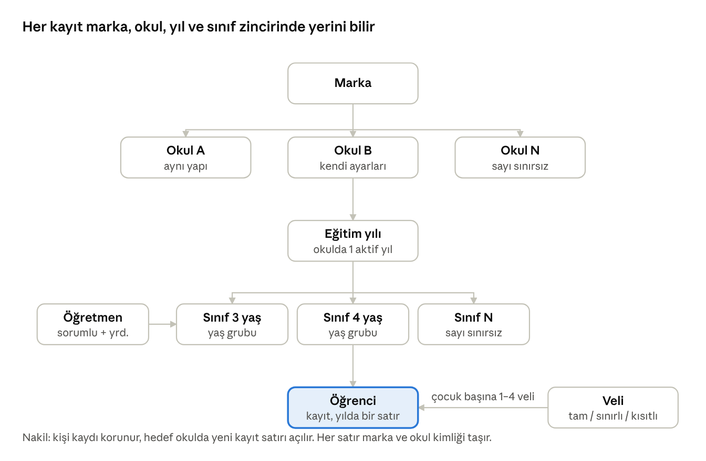
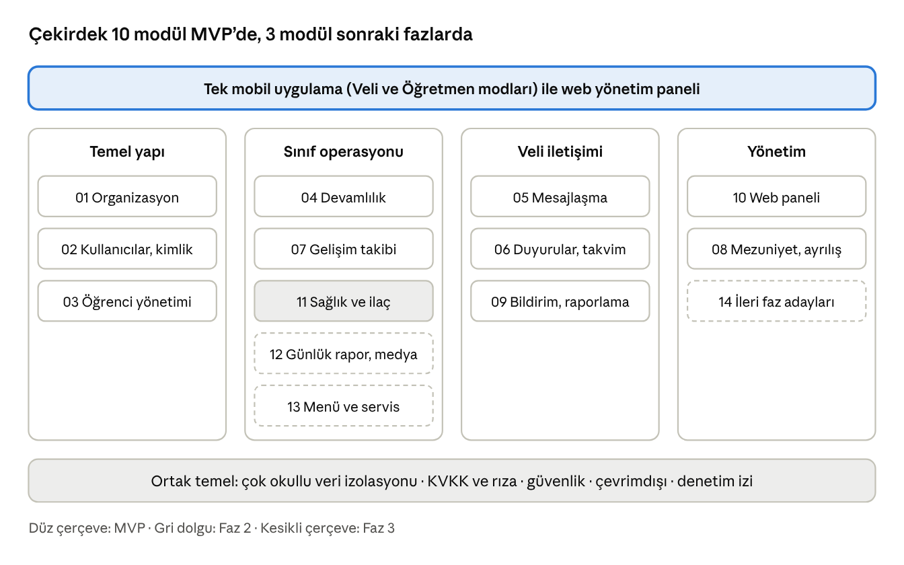

# Anaokulu Platformu – Analiz Dokümanı

14 Ekim 2026 · Aykut Eren
Önerilen çözüm: veli ve öğretmenlerin kullandığı tek bir mobil uygulama (Veli ve Öğretmen modları) ile yalnızca okul yönetiminin kullandığı bir web paneli. Platform marka → okul → eğitim yılı → sınıf → öğrenci hiyerarşisi üzerine kurulur, birden çok okulu tek markada yönetir ve KVKK gereklerine göre tasarlanır. MVP öğrenci yaşam döngüsü, yoklama, mesajlaşma, duyuru ve temel gelişim takibini kapsar; günlük rapor gibi acil olmayan modüller sonraki fazlara bırakılmıştır.

## Yönetici özeti

Platform, markanın tüm okullarındaki öğrenci, veli ve öğretmen etkileşimini tek bir mobil uygulamada toplar; yönetim web panelinden çalışır. İlk sürüm (MVP) velinin her gün açacağı dört işi çözer: yoklama ve devamsızlık, öğretmenle mesajlaşma, duyurular ve çocuğun gelişim raporu.

**Alınan kararlar**

- Tek mobil uygulama, iki mod: Veli ve Öğretmen. Yöneticiler mobilde özet görür, asıl işlerini web panelinde yapar; veliler web paneline hiç girmez.
- Veri marka → okul → eğitim yılı → sınıf → öğrenci hiyerarşisinde tutulur. Her kayıt marka ve okul kimliği taşır; ikinci bir marka eklemek veri taşıması gerektirmez.
- Veli hesabı telefon numarasına bağlıdır (SMS doğrulama). Bir veli, markanın farklı okullarındaki çocuklarını tek hesaptan izler.
- Mezun olan veya ayrılan öğrencinin velisi salt-okunur sürenin (öneri 30 gün, 0 gün da seçilebilir; S3) sonunda uygulamayla bağını yitirir. İlişkinin kalmaması erişimin kapanması demektir; veriler yasal saklama süresi boyunca kapalı tutulur, sonra anonimleştirilir.
- Günlük rapor, sağlık ve servis modülleri bilinçli olarak sonraki fazlara bırakıldı. Aidat tahsilatı kapsam dışı aday modüldür.

**Fazlar**

- MVP: organizasyon, kullanıcılar, öğrenci yaşam döngüsü, yoklama, mesajlaşma, duyurular, temel gelişim takibi, mezuniyet erişim iptali, bildirimler, web paneli çekirdeği. Tek okulda pilot.
- Faz 2: tam gelişim takibi (portfolyo, onay akışı), takvim ve izin formları, sağlık ve ilaç, gelişmiş raporlar, çevrimdışı sağlamlaştırma.
- Faz 3: günlük rapor ve medya galerisi, yemek menüsü, servis biniş-iniş, aday modüller (aidat, ön kayıt).

**En büyük riskler**

- Veli benimsemesi: WhatsApp alışkanlığı sürerse uygulama ikinci kanal olur. Önlem: okul iletişimi yalnızca uygulamadan yapılır, hesap kayıt anında açılır.
- Öğretmen iş yükü: yoklama ve gelişim girişleri günde 10 dakikayı aşarsa terk edilir. Önlem: toplu giriş, şablonlar, çevrimdışı çalışma.
- Çocuk verisi: fotoğraf ve sağlık verisi sızıntısı itibar ve hukuk riski taşır. Önlem: rıza modeli, rol bazlı erişim, denetim izi, hukuk görüşü.
- Çok okullu veri karışması: bir okulun verisinin başka okulda görünmesi. Önlem: her sorguda marka ve okul filtresi, otomatik izolasyon testleri.

## Vizyon, hedefler ve başarı ölçütleri

Vizyon: veli çocuğuyla ilgili her bilgiyi tek yerden, gününde ve doğru kişiden alır; öğretmen kâğıt, WhatsApp ve Excel yerine tek araçla çalışır; yönetim bütün okulları tek ekrandan görür.

**Hedefler**

- Veli iletişimini tek kanala taşımak: WhatsApp grupları ve kâğıt notlar MVP'den altı ay sonra kapanır.
- Devamsızlığı aynı gün görünür kılmak: haber verilmemiş her devamsızlık yoklama kesinleştikten 15 dakika sonra veliye sorulur.
- Gelişim takibini kayıt altına almak: her çocuk için dönemde en az bir değerlendirme raporu velisiyle paylaşılır.
- Yönetime ölçülebilir görünürlük vermek: okul ve sınıf bazında devam, iletişim ve rapor tamamlama oranları.
- Mezuniyette temiz ayrılık: mezun velinin erişimi süreç sonunda kendiliğinden kapanır, elle takip gerekmez.

**Başarı ölçütleri** (öneri; pilotta kalibre edilir)

| Ölçüt | Hedef | Nasıl ölçülür |
| --- | --- | --- |
| Veli hesap aktivasyonu | Kayıtlı çocukların velilerinin en az %85'i ilk 30 günde giriş yapar | Kullanıcı modülü, aktivasyon raporu |
| Günlük yoklama tamamlanma | Okul günlerinin en az %95'inde tüm sınıflar yoklamayı belirlenen saate kadar girer | Devamlılık raporu |
| Duyuru okunma oranı | Önemli duyurularda 24 saat içinde en az %80 okundu | Duyuru raporu |
| Veli mesajına yanıt süresi | Çalışma saatlerinde ortalama 2 saatin altında | Mesajlaşma raporu |
| Gelişim raporu kapsaması | Her dönem her aktif çocuk için en az 1 yayınlanmış rapor | Gelişim raporu |
| Haftalık aktif veli | Aktif velilerin en az %70'i haftada en az bir kez uygulamayı açar | Kullanım analitiği |
| Mezuniyet sonrası açık erişim | Salt-okunur süre bitiminde açık kalan veli erişimi: 0 | Mezuniyet denetim raporu |

## Kapsam

Kapsam, hikayedeki altı ihtiyaç etrafında çizilmiştir: öğrenci takibi, veri temelli veli iletişimi, duyurular, devamlılık, gelişim takibi ve mezuniyette temiz ayrılış. Tablo her başlığın hangi fazda ele alındığını gösterir.

| Konu | Kapsam | Faz |
| --- | --- | --- |
| Marka altında çoklu okul, okul altında çoklu sınıf | Kapsam içi | MVP |
| Veli ve öğretmen mobil uygulaması (iOS, Android) | Kapsam içi | MVP |
| Yönetim web paneli (marka ve okul yöneticileri) | Kapsam içi | MVP |
| Öğrenci kaydı, veli bağlantısı, sınıf ataması, nakil | Kapsam içi | MVP |
| Günlük yoklama, devamsızlık bildirimi, mazeret | Kapsam içi | MVP |
| Veli–öğretmen ve veli–okul mesajlaşması | Kapsam içi | MVP |
| Duyurular (marka / okul / sınıf) ve okunma takibi | Kapsam içi | MVP |
| Gelişim takibi: gözlem notu ve dönemlik rapor | Kapsam içi | MVP temel, Faz 2 tam |
| Mezuniyet ve ayrılışta erişim iptali, veri saklama | Kapsam içi | MVP |
| Anlık bildirim altyapısı ve temel raporlar | Kapsam içi | MVP |
| Okul takvimi (gün türleri: okul günü, tatil, yarım gün, kapalı) | Kapsam içi | MVP (01) |
| Etkinlik takvimi, izin formu, görüşme randevusu | Kapsam içi | Faz 2 |
| Sağlık profili, ilaç uygulama, kaza bildirimi | Kapsam içi | Faz 2 |
| Günlük rapor (yemek, uyku, tuvalet) ve medya galerisi | Kapsam içi | Faz 3 |
| Yemek menüsü, servis biniş-iniş | Kapsam içi | Faz 3 |
| Aidat ve ödemeler, ön kayıt (CRM), İK, envanter | Aday | Faz 3 ve sonrası |
| Velilerin web erişimi | Kapsam dışı | – |
| Mezun veliyle pazarlama veya mezunlar iletişimi | Kapsam dışı | – |
| Başka markalara SaaS satışı (self-servis kayıt, plan, white-label) | Kapsam dışı | – |
| Öğrencinin kendisinin kullandığı bir uygulama | Kapsam dışı | – |

## Paydaşlar ve personalar

Günlük kullanıcılar veli ve öğretmendir; yönetim rolleri çoğunlukla web panelinde çalışır. Her persona için birincil cihaz, en sık yaptığı iş ve bugünkü sorun noktası aşağıdadır.

| Persona | Rol | Cihaz | En sık yaptığı iş | Bugünkü sorun |
| --- | --- | --- | --- | --- |
| Veli (anne, baba veya yasal vasi) | Veli | Telefon | Çocuğunun gününü görmek, devamsızlık bildirmek, öğretmene yazmak, duyuru okumak | Bilgi WhatsApp gruplarına dağılmış, kişisel numaralar paylaşılıyor |
| Sınıf öğretmeni | Öğretmen | Telefon, ara sıra web | Yoklama, veli mesajları, gözlem notu, dönem raporu | Kâğıt yoklama, mesai dışı mesajlar, raporlar Word'de |
| Yardımcı öğretmen | Yardımcı öğretmen | Telefon | Yoklama ve teslim kaydı, sınıf mesajlarını görme | Yetkisi belirsiz, bilgi sözlü aktarılıyor |
| Okul müdürü | Okul müdürü | Web, telefon | Okul duyuruları, devam ve iletişim raporları, kayıt ve sınıf yönetimi | Okulun durumunu görmek için öğretmenleri tek tek aramak |
| Okul sekreteri / ofis | Ofis | Web | Kayıt, veli davetleri, belge ve izin formları, veli–ofis mesajları | Excel listeleri, telefonla bilgi toplama |
| Marka genel yöneticisi | Marka yöneticisi | Web | Okullar arası karşılaştırma, standart ayarlar, marka duyuruları | Her okuldan farklı formatta rapor |
| Hemşire / sağlık sorumlusu (okulda varsa) | Sağlık sorumlusu | Telefon, web | İlaç taleplerini onaylamak, alerji listesi, kaza kaydı | Kâğıt sağlık dosyası |
| Servis hostesi (Faz 3) | Servis hostesi | Telefon | Biniş-iniş kaydı | Veliyi telefonla aramak |

## Organizasyon modeli

Okul ve sınıf sayısı sınırsızdır; her okulun kendi eğitim yılı ve ayarları vardır, marka ortak standartları kilitleyebilir. Öğretmen sınıfa, veli çocuğa bağlanır; yetkiler bu bağlardan türetilir (Roller ve Yetkiler).

## Modül haritası

Her modülün ayrıntılı analizi Modüller sekmesinin altındaki numaralı sayfadadır; 14 İleri Faz sayfası aidat, ön kayıt ve İK gibi adayları toplar.

## Platform ve deneyim ilkeleri

Tek mobil uygulama iki modla çalışır; hangi modun açılacağını kullanıcının rolleri belirler, iki rolü olan kullanıcı (örneğin aynı okulda çocuğu olan öğretmen) üstten mod değiştirir.

- **Mobil önce**: veli ve öğretmen işlerinin tamamı telefonda yapılır. Web yalnızca yönetim içindir; öğretmen isterse uzun gelişim raporlarını web'de yazabilir (Faz 2).
- **Tek uygulama, iki mod**: ayrı Veli ve Öğretmen uygulamaları yerine tek mağaza kaydı, ortak bileşenler, tek sürüm döngüsü. İlk açılış ekranı her iki rolü de anlatır.
- **Üç dokunuş kuralı**: velinin en sık dört işi (bugünkü durum, devamsızlık bildir, öğretmene yaz, duyurular) ana ekrandan en fazla üç dokunuşla yapılır.
- **Öğretmen için toplu işlem**: yoklama ve gözlem girişleri sınıf listesinden toplu yapılır; tek tek çocuk ekranı istisnalar içindir. Günlük toplam giriş süresi hedefi sınıf başına 10 dakikanın altıdır.
- **Çevrimdışı dayanıklılık**: yoklama ve gözlem notu bağlantı yokken girilir, bağlantı gelince gönderilir. Veli tarafı çevrimiçi çalışır, son görülen veri önbellekte kalır.
- **Bildirim disiplini**: her olay bildirim üretmez; günlük özetler birleştirilir, sessiz saatlerde yalnızca acil bildirimler geçer.
- **Türkçe önce**: arayüz Türkçe; İngilizce ikinci dil olarak altyapıda hazır, içerik çevirisi kapsam dışı.
- **Rol ne görüyorsa onu görür**: her ekran kullanıcının kapsamına (marka, okul, sınıf, çocuk) göre süzülür; yetkisi olmayan veri API'den hiç dönmez.
- **Erişilebilirlik**: büyük yazı desteği, yeterli kontrast, ekran okuyucu etiketleri; veli kitlesinde yaşlı büyükanne ve büyükbaba vasiler de vardır.

Alternatif: iki ayrı uygulama (Veli, Öğretmen). Artısı mağazada net konumlanma ve daha küçük uygulama boyutu; eksisi iki sürüm döngüsü, iki mağaza süreci ve ortak kodun kopyalanması. Öneri tek uygulamadır; karar Riskler ve Açık Sorular sekmesinde açık soru olarak izlenir.

## Fazlama özeti

MVP tek okulda pilotla doğrulanır; sonraki fazlar tüm okullara yayılmış bir platformun üstüne eklenir. Ayrıntılı plan, kapı kriterleri ve kaba büyüklükler Yol Haritası sekmesindedir.

| Faz | Modüller | Çıktı | Kapı kriteri |
| --- | --- | --- | --- |
| Faz 0 Hazırlık | – | 2 okulda kullanıcı araştırması, tasarım sistemi, KVKK metinleri (hukuk görüşü), mağaza hesapları, mimari karar kaydı | Kapsam ve mimari onayı (proje sahibi); KVKK metinleri hazır; açık soruların en az %80'i kararlaştırılmış |
| MVP (Faz 1) | 01 Organizasyon, 02 Kullanıcılar, 03 Öğrenci, 04 Devamlılık, 05 Mesajlaşma, 06 Duyurular, 07 Gelişim (temel), 08 Mezuniyet, 09 Bildirimler ve temel raporlar, 10 Web paneli (çekirdek) | Mağazalarda yayınlanmış uygulama, bir okulda pilot | Pilot okulda veli hesap aktivasyonu en az %85 (ilk 30 gün); yoklama tamamlama en az %95; açık kritik hata yok; KVKK uyum kontrolü geçti |
| Faz 2 | 07 Gelişim (tam: portfolyo, onay, görüşme), 06 Takvim, etkinlik, izin formu, randevu; 11 Sağlık ve ilaç; gelişmiş raporlar; çevrimdışı sağlamlaştırma | Tüm okullarda yaygın kullanım | Tüm okullarda aktivasyon en az %85; dönem raporu kapsaması %100; sağlık verisi rıza oranı ölçüldü |
| Faz 3 | 12 Günlük rapor ve medya galerisi, 13 Yemek menüsü ve servis, 14 aday modüller (aidat, ön kayıt) | Günlük akış ve ek hizmetler | Medya depolama maliyeti bütçede; aday modüllerin kabulü değişiklik kurulunda (aidat için ödeme sağlayıcı ve muhasebe kararı Faz 3'e giriş koşuludur) |

## Varsayımlar ve alınan kararlar

Aşağıdaki kararlar analiz sırasında alınmış ve dokümanın tamamında varsayılmıştır; biri değişirse ilgili modül sayfaları güncellenir.

| # | Karar / varsayım | Kaynak | Etkilediği yer |
| --- | --- | --- | --- |
| K1 | Platform tek markaya aittir; model ikinci markayı taşıyabilecek şekilde (marka kimliği her kayıtta) kurulur. SaaS özellikleri (self-servis kayıt, plan, white-label) kapsam dışı | Proje sahibi kararı, 14 Ekim 2026 | Veri modeli, yetki kapsamı |
| K2 | Doküman dili Türkçe; teknik terimler İngilizce, Sözlük sekmesinde | Proje sahibi kararı | – |
| K3 | Acil olmayan modüller (günlük rapor, sağlık, menü, servis) sona bırakıldı; en değerli modüller (öğrenci, devam, iletişim, gelişim, mezuniyet) önce | Proje sahibi kararı, 14 Ekim 2026 | Fazlama, sekme sırası |
| K4 | Aidat ve ödemeler ileri faz adayıdır; MVP'de yoktur | Proje sahibi kararı | Kapsam |
| K5 | Veliler yalnızca mobil uygulama kullanır; web paneli yönetim içindir | Hikaye | Platform tasarımı |
| K6 | Tek mobil uygulama, Veli ve Öğretmen modları (iki ayrı uygulama yerine) | Analiz önerisi, açık soru | Mobil mimari |
| K7 | Veli kimliği telefon numarasıdır; SMS doğrulama koduyla giriş | Analiz önerisi, açık soru | Kimlik modülü, SMS maliyeti |
| K8 | Mezuniyet ve ayrılış sonrası salt-okunur süre 30 gün; sonrasında erişim kapanır | Analiz önerisi, açık soru | Mezuniyet modülü |
| K9 | Mezun veliyle pazarlama veya mezunlar iletişimi yapılmaz | Hikaye (“uygulamayla ilgisi kalmamalı”) | Veri saklama, rıza |
| K10 | Ölçek varsayımı: en çok 5 okul × 12 sınıf × 20 öğrenci, yaklaşık 1.200 öğrenci, 2.400 veli, 150 personel; tasarım 10 katına göre | Analiz varsayımı | NFR hedefleri |
| K11 | Barındırma Türkiye'de; yurt dışı seçeneği hukuk görüşüne bağlı | Analiz önerisi, açık soru | Altyapı, KVKK |
| K12 | Teknoloji yığını öneridir (Flutter, Spring Boot, Vue 3, PostgreSQL); ekip deneyimine göre değişebilir | Analiz önerisi | Teknik Mimari sekmesi |
| K13 | Gelişim göstergeleri MEB Okul Öncesi Eğitim Programı gelişim alanlarına göre yapılandırılır; güncel program metniyle doğrulanmalı | Analiz varsayımı | Gelişim modülü |
| K14 | Yasal saklama süreleri hukuk görüşüyle belirlenir; dokümandaki süreler yer tutucudur | Analiz varsayımı | Mezuniyet, KVKK |
| K15 | Öğretmen web paneline MVP'de girmez; Faz 2'de uzun gelişim raporlarını yazmak için isteğe bağlı girer (S16) | Analiz önerisi, açık soru | Roller ve Yetkiler, 07, 10 |
