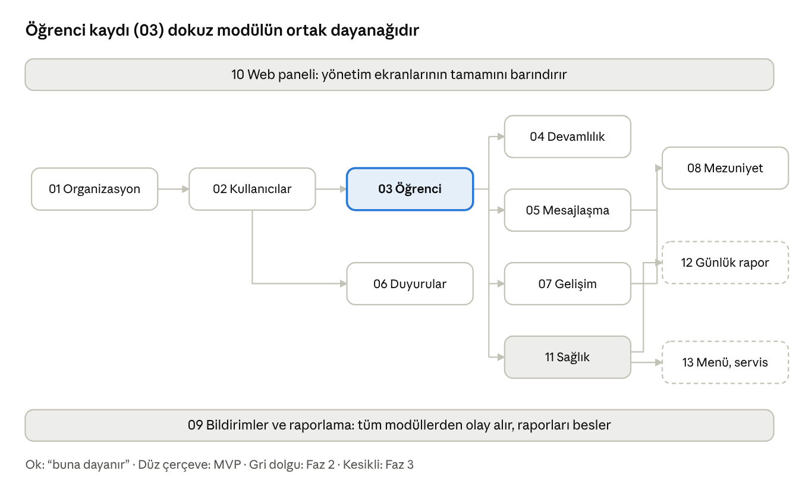

# Modüller

Platform 13 ana modülden oluşur; 14 numaralı sayfa ileri faz adaylarını toplar; alt sekmeler değer sırasıyla dizilmiştir: temel yapı, öğrenci ve devam, iletişim, gelişim ve mezuniyet önce; sağlık, günlük rapor ve servis sonra.

## Modül listesi

Sıralama değere göredir: hikayedeki çekirdek ihtiyaçlar (01–08) MVP'yi oluşturur, 09–10 onları taşıyan altyapı ve yönetim katmanıdır, 11–14 sonraki fazlardır. Faz sütunu açılır listedir; karar değişirse buradan güncellenir.

| # | Modül | Birincil kullanıcılar | Ne sağlar | Faz | Sayfa |
| --- | --- | --- | --- | --- | --- |
| 01 | Organizasyon ve Akademik Yapı | Marka ve okul yöneticileri | Marka, okul, eğitim yılı, sınıf, yaş grubu; yıl sonu devir | MVP | [01 Organizasyon ve Akademik Yapı](moduller/01-organizasyon-ve-akademik-yapi.md) |
| 02 | Kullanıcılar, Kimlik ve Erişim | Tüm roller | Davet, SMS doğrulama ile veli girişi, personel hesapları, oturum ve cihaz yönetimi | MVP | [02 Kullanıcılar, Kimlik ve Erişim](moduller/02-kullanicilar-kimlik-ve-erisim.md) |
| 03 | Öğrenci Yönetimi ve Yaşam Döngüsü | Ofis, yöneticiler, öğretmen, veli | Kayıt, veli bağlantısı, teslim yetkilileri, nakil, durumlar | MVP | [03 Öğrenci Yönetimi ve Yaşam Döngüsü](moduller/03-ogrenci-yonetimi-ve-yasam-dongusu.md) |
| 04 | Devamlılık Takibi | Öğretmen, veli, yöneticiler | Günlük yoklama, devamsızlık bildirimi, mazeret, raporlar | MVP | [04 Devamlılık Takibi](moduller/04-devamlilik-takibi.md) |
| 05 | Mesajlaşma | Veli, öğretmen, ofis | Çocuk bazlı veli–öğretmen kanalı, veli–ofis kanalı, sınıf toplu mesajı | MVP | [05 Mesajlaşma](moduller/05-mesajlasma.md) |
| 06 | Duyurular, Takvim ve Etkinlikler | Yöneticiler, öğretmen, veli | Kapsamlı duyuru ve okundu takibi; takvim, etkinlik, izin formu, randevu (Faz 2) | MVP | [06 Duyurular, Takvim ve Etkinlikler](moduller/06-duyurular-takvim-ve-etkinlikler.md) |
| 07 | Gelişim Takibi | Öğretmen, veli, yöneticiler | Gözlem notu, dönemlik değerlendirme, veli raporu; portfolyo ve onay akışı (Faz 2) | MVP | [07 Gelişim Takibi](moduller/07-gelisim-takibi.md) |
| 08 | Mezuniyet ve Ayrılış | Yöneticiler, ofis, veli | Yıl sonu mezuniyet, ayrılış, salt-okunur süre, erişim iptali, saklama | MVP | [08 Mezuniyet ve Ayrılış](moduller/08-mezuniyet-ve-ayrilis.md) |
| 09 | Bildirimler ve Raporlama | Tüm roller, yöneticiler | Anlık bildirim motoru ve tercihler; devam, iletişim ve gelişim raporları | MVP | [09 Bildirimler ve Raporlama](moduller/09-bildirimler-ve-raporlama.md) |
| 10 | Web Yönetim Paneli | Marka ve okul yöneticileri, ofis | Kurulum, kullanıcılar, öğrenciler, ayarlar, raporlar, KVKK talepleri | MVP | [10 Web Yönetim Paneli](moduller/10-web-yonetim-paneli.md) |
| 11 | Sağlık ve İlaç Takibi | Veli, öğretmen, sağlık sorumlusu | Sağlık profili, ilaç talebi ve uygulama kaydı, kaza bildirimi | Faz 2 | [11 Sağlık ve İlaç Takibi](moduller/11-saglik-ve-ilac-takibi.md) |
| 12 | Günlük Rapor ve Medya Galerisi | Öğretmen, veli | Yemek, uyku, tuvalet, etkinlik girişi; rızaya bağlı fotoğraf paylaşımı | Faz 3 | [12 Günlük Rapor ve Medya Galerisi](moduller/12-gunluk-rapor-ve-medya-galerisi.md) |
| 13 | Yemek Menüsü ve Servis | Ofis, veli, servis hostesi | Haftalık menü, alerjen eşleştirme, servis biniş-iniş | Faz 3 | [13 Yemek Menüsü ve Servis](moduller/13-yemek-menusu-ve-servis.md) |
| 14 | İleri Faz Modülleri | – | Aidat, ön kayıt, İK, anket, envanter, MEB veri uyumu, canlı konum | Aday (Faz 3 ve sonrası) | [14 İleri Faz Modülleri](moduller/14-ileri-faz-modulleri.md) |
## Modül bağımlılıkları

Soldan sağa sıra aynı zamanda inşa sırasıdır: organizasyon ve kullanıcılar olmadan öğrenci kaydı, öğrenci kaydı olmadan yoklama, mesaj ve gelişim modülleri çalışamaz. Mezuniyet, mesaj ve gelişim verisini kapattığı için en sağdadır.

## Modül sayfalarının yapısı

Her modül sayfası aynı altı bölümle yazılmıştır; okuyucu bir modülde alıştığı yerde diğerinde de aynı bilgiyi bulur.

1. Amaç, kapsam ve aktörler: modülün çözdüğü iş, neyin dahil olmadığı, hangi rollerin kullandığı.
2. Kullanıcı hikayeleri: “rol olarak … istiyorum, böylece …” biçiminde; her satırda MoSCoW önceliği ve faz açılır listesi.
3. İş kuralları ve işlevsel gereksinimler: numaralı, test edilebilir kurallar.
4. Süreç akışı: dallanan veya el değiştiren süreçlerde çizim (03, 04, 07, 08); düz akışlarda numaralı liste kuralların içindedir.
5. Veri, ekranlar ve bildirimler: modülün varlıkları, ekran listesi (platform sütunuyla) ve ürettiği bildirimler.
6. Uç durumlar, kabul kriterleri ve açık sorular: sınır durumlar, “bitti” tanımı ve karar bekleyen maddeler.

Öncelik ölçeği hikayenin kendi fazına göre okunur: Must = o fazda olmazsa modül çalışmaz; Should = o fazda beklenir, gerekirse ertelenir; Could = faydalı, sıkışırsa ilk ertelenen; Won't = bu faz için bilinçli olarak dışarıda.
