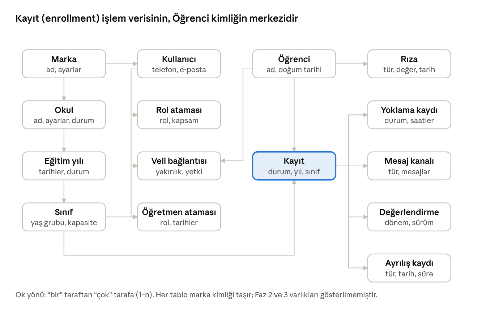
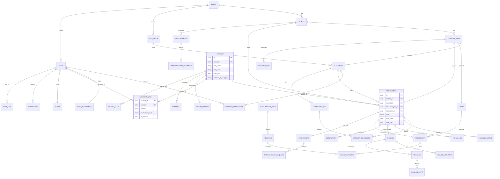

# Veri Modeli

Veri modeli marka ve okul kimliğini her kayda taşır; kişi kaydı ile yıllık kayıt ayrımı, mezuniyet ve yeniden kayıt senaryolarını tarihçeyi bozmadan destekler.

## Temel varlıklar ve ilişkiler

İki merkez vardır: Öğrenci (kişi) kimliği, veli bağlantılarını ve rızaları taşır; Kayıt (enrollment) ise okul, yıl ve sınıfa bağlıdır ve yoklama, mesaj, değerlendirme ve ayrılış gibi işlem verisi ona bağlanır. Nakil ve yeniden kayıt aynı Öğrenci altında yeni Kayıt satırı demektir.

## Varlık sözlüğü

Her tabloda ortak alanlar vardır: id (UUID), brand\_id, created\_at, updated\_at, created\_by, updated\_by; okula bağlı tablolarda school\_id; GuardianLink ve MediaTag gibi bağlantı tabloları id yerine bileşik anahtar kullanır. Aşağıda yalnızca varlığa özgü anahtar alanlar listelenir; ayrıntılı alanlar modül sayfalarındadır.

| Varlık | Anahtar alanlar | Sahibi modül | Not |
| --- | --- | --- | --- |
| Brand (Marka) | ad, logo, tema, varsayılan ayarlar | 01 | Tek kayıt; model çoklu markaya hazır |
| School (Okul) | ad, adres, iletişim, durum, ayarlar | 01 |  |
| AcademicYear (Eğitim yılı) | school\_id, ad, başlangıç, bitiş, durum | 01 | Okul başına bir aktif |
| Term (Dönem) | academic\_year\_id, ad, tarihler, rapor son tarihi | 07 |  |
| CalendarDay (Okul takvimi günü) | academic\_year\_id, tarih, gün türü (okul günü / tatil / yarım gün / kapalı), açıklama | 01 | MVP; 04 ve 09 kullanır, 06 Faz 2'de etkinlik bağlar |
| AgeGroup (Yaş grubu) | ad, doğum tarihi kuralı, sıra, mezuniyet grubu | 01 | Marka düzeyinde |
| Classroom (Sınıf) | school\_id, academic\_year\_id, age\_group\_id, ad, kapasite, durum | 01 |  |
| TeacherAssignment (Öğretmen ataması) | classroom\_id, user\_id, rol, başlangıç, bitiş | 01 | Yetki kapsamını belirler |
| User (Kullanıcı) | roller (veli ve/veya personel), telefon, e-posta, ad, durum, dil | 02 | Veli ve personel |
| RoleAssignment (Rol ataması) | user\_id, rol, kapsam türü, kapsam id, tarihler | 02 |  |
| Device, Session, SecurityEvent, Preference | cihaz, oturum, güvenlik olayı, tercih | 02 |  |
| Student (Öğrenci, kişi) | ad, soyad, doğum tarihi, cinsiyet, fotoğraf, kimlik no (şifreli), adres | 03 | Okuldan bağımsız |
| Enrollment (Kayıt) | student\_id, school\_id, academic\_year\_id, classroom\_id, age\_group\_id, durum, başlangıç, bitiş, ayrılış nedeni | 03 | Okul–yıl başına bir satır; nakilde yeni satır; iş kayıtlarının çoğu buna bağlanır |
| GuardianLink (Veli bağlantısı) | student\_id, user\_id, yakınlık, yetki düzeyi, birincil | 03 |  |
| PickupPerson, EmergencyContact | teslim yetkilisi, acil kişi | 03 |  |
| Consent (Rıza) | student\_id, tür, değer, veren user\_id, kaynak (uygulama / kâğıt form), zaman, metin sürümü | 03 | Geçmiş tutulur |
| HealthFlag (Sağlık işareti) | student\_id, tür, şiddet, açıklama | 03, 11 | Özel nitelikli |
| AttendanceDay (Yoklama günü) | classroom\_id, tarih, durum, giren, kesinleşme | 04 |  |
| AttendanceRecord (Yoklama kaydı) | attendance\_day\_id, enrollment\_id, durum, geliş, ayrılış, neden, kaynak | 04 | Değişiklik geçmişi |
| AbsenceNotice, PickupLog, AttendanceAlert | devamsızlık bildirimi, teslim kaydı, uyarı | 04 |  |
| Channel (Kanal) | tür, school\_id, enrollment\_id, durum | 05 |  |
| ChannelMember, Message, ReadReceipt, Template, Broadcast | üyelik, mesaj, okundu, şablon, toplu mesaj | 05 |  |
| Announcement (Duyuru) | kapsam, tür, başlık, içerik, ekler, yazar, onay, yayın, son geçerlilik, sabit, sürüm | 06 |  |
| AnnouncementRecipient | announcement\_id, user\_id, okundu, onay | 06 |  |
| Event, Rsvp, PermissionForm, PermissionApproval, MeetingSlot | etkinlik, katılım, izin formu, onay, randevu zaman dilimi | 06 | Faz 2 |
| DevelopmentArea, Indicator | gelişim alanı, gösterge (sürümlü) | 07 | Marka kataloğu |
| Observation (Gözlem notu) | enrollment\_id, yazar, tarih, alan, gösterge, metin, medya, paylaşıldı | 07 |  |
| Assessment, AssessmentItem, ReportComment | değerlendirme (sürümlü), satır, yorum | 07 |  |
| PortfolioItem, MeetingNote, WeeklyPlan, SupportFlag | portfolyo, görüşme notu, haftalık plan, destek işareti | 07 | Faz 2 |
| ExitRecord (Ayrılış kaydı) | enrollment\_id, tür, tarih, neden, salt-okunur bitişi | 08 |  |
| DataPackageRequest, RetentionPolicy, AnonymizationJob, LegalHold | veri paketi, saklama politikası, anonimleştirme işi, yasal bekletme | 08 |  |
| DomainEvent, EventRule, Notification, NotificationTemplate, DigestQueue, ReportSnapshot | olay, kural, bildirim, şablon, özet kuyruğu, rapor özeti | 09 |  |
| ApprovalItem, ImportJob, TextVersion, TextAcceptance, DsarRequest, AuditLog | onay öğesi, içe aktarma, metin sürümü, onay, KVKK talebi, denetim kaydı | 10 |  |
| HealthProfile, MedicationRequest, MedicationLog, IncidentReport | sağlık profili, ilaç talebi, uygulama kaydı, kaza raporu | 11 | Faz 2 |
| ReportTemplate, DailyReport, DailyReportItem, NeedRequest, MorningNote, MediaItem, MediaTag, Album, Reaction | rapor şablonu, günlük rapor, kalem, ihtiyaç isteği, sabah notu, medya, etiket, albüm, beğeni | 12 | Faz 3 |
| Menu, MenuItem, AllergenConflict, Route, RouteStop, RouteAssignment, BoardingLog, TransportCancellation | menü, kalem, alerjen çakışması, güzergah (araç plakası alanı), durak, atama, biniş kaydı, servis iptali | 13 | Faz 3 |

## Durum makineleri

Durum taşıyan varlıklar aşağıdadır; öğrenci kaydı (03) ve ayrılış (08) akışları ilgili sayfalarda çizilmiştir. Her geçiş kim ve ne zaman bilgisiyle denetim izine düşer.

| Varlık | Durumlar | Geçişi tetikleyen | Modül |
| --- | --- | --- | --- |
| Kayıt (Enrollment) | aday, kayıtlı, aktif, dondurulmuş, mezun, ayrıldı; kayıtlı → ayrıldı (hiç başlamadı), mezun → aktif (72 saat geri alma), mezun veya ayrıldı → kayıtlı (yeniden kayıt) | Ofis, müdür, yıl sonu devir işi | 03 |
| Yoklama günü | açık, kesinleşti, kilitli | Öğretmen gönderimi; kilit saati (okul ayarı, varsayılan 18:00) | 04 |
| Yoklama kaydı | geldi, geç geldi, gelmedi mazeretli, gelmedi mazeretsiz (erken ayrılış ayrı durum değil, ayrılış saati alanı) | Öğretmen, veli yanıtı, ofis düzeltmesi | 04 |
| Devamsızlık bildirimi | bildirildi, yoklamaya işlendi, belge onaylandı | Veli, sistem, ofis | 04 |
| Kanal | açık, arşiv | Sınıf değişikliği, nakil, mezuniyet | 05 |
| Mesaj | gönderildi, iletildi, okundu; düzenlendi; geri alındı | Gönderen, alıcı cihazı | 05 |
| Duyuru | taslak, onay bekliyor, yayınlandı, süresi doldu, arşiv | Yazar, müdür, zamanlayıcı | 06 |
| İzin formu onayı | bekliyor, onaylandı, hayır, geri alındı | Veli | 06 (Faz 2) |
| Değerlendirme (rapor) | taslak, onay bekliyor, geri gönderildi, yayınlandı (sürümlü) | Öğretmen, müdür | 07 |
| Ayrılış kaydı | başlatıldı, salt-okunur, erişim kapalı, saklamada, anonimleştirildi; yasal bekletme durdurur | Müdür, ofis, zamanlanmış işler | 08 |
| Veri paketi | talep, hazırlanıyor, hazır, indirildi, süresi doldu | Veli, iş kuyruğu | 08 |
| Kullanıcı | davet edildi, aktif, askıda, kapalı | Ofis, müdür, sistem | 02 |
| Eğitim yılı ve sınıf | planlanan, aktif, arşiv | Yıl başlangıcı ve bitişi | 01 |
| Bildirim | oluşturuldu, gönderildi, teslim edildi, açıldı, başarısız | Bildirim motoru, cihaz | 09 |
| KVKK talebi | açık, inceleniyor, yanıtlandı, reddedildi | Ofis, müdür | 10 |
| İlaç talebi | talep, onaylandı, reddedildi, uygulanıyor, tamamlandı | Veli, sağlık sorumlusu, öğretmen | 11 (Faz 2) |
| Günlük rapor | taslak, yayınlandı, kilitli (48 saat) | Öğretmen | 12 (Faz 3) |

## Mermaid ERD (geliştiriciler için)

Aşağıdaki blok çekirdek ilişkileri Mermaid sözdizimiyle verir; geliştirici kopyalayıp kendi aracında açabilir. Ortak alanlar (id, brand\_id, zaman damgaları) ve Faz 2 ile Faz 3 varlıkları kısalık için dışarıda bırakılmıştır.

