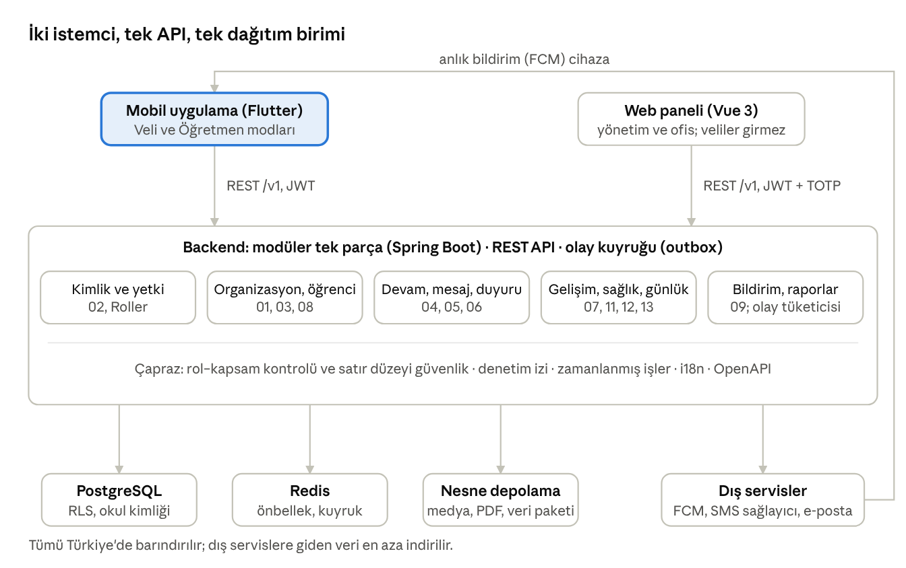

# Teknik Mimari

Öneri: tek Flutter uygulaması, Vue 3 web paneli ve Spring Boot ile modüler tek parça bir arka uç; PostgreSQL, nesne depolama, FCM ve yerli SMS sağlayıcısı, Türkiye'de barındırma. Son karar Faz 0'daki ekip envanteri ve mimari denemeyle verilir (K12).

## Öneri özeti ve mimari ilkeler

Önerilen mimari: tek mobil uygulama (Flutter), Vue 3 web paneli ve modüler tek parça (modular monolith) bir arka uç; PostgreSQL, Redis, S3 uyumlu nesne depolama, FCM anlık bildirim, yerli SMS sağlayıcısı ve Türkiye'de barındırma. Bu bir öneridir: ekibin mevcut deneyimi (önceki projelerinde Spring Boot ve Vue) seçimin belirleyicisidir ve Faz 0'daki mimari deneme ile kesinleşir (K12).

1. **Modüler tek parça**: tek dağıtım birimi, modül sınırları kodda net (paket başına modül); mikroservis yok. Ölçek (K10) ve ekip boyutu buna uygundur; bildirim ve medya işleme ileride ayrı servise çıkarılabilir.
2. **API öncelikli**: mobil ve web aynı REST API'yi kullanır; sürümlü, OpenAPI sözleşmeli, istemci kodu üretilir.
3. **Olay güdümlü iç iletişim**: modüller olay yayınlar (outbox deseni); bildirim, raporlama ve mezuniyet işleri olayları tüketir.
4. **Veri izolasyonu veritabanında**: marka ve okul sütunları ile satır düzeyi güvenlik (Kesişen Konular).
5. **Çevrimdışı öncelikli mobil veri katmanı** öğretmen modunda; veli modu çevrimiçi.
6. **Gözlemlenebilirlik baştan**: yapılandırılmış log, metrik ve iz (OpenTelemetry), hata izleme.
7. **Altyapı kod olarak**: üç ortam (geliştirme, test, canlı; pilot canlıda tek okulla); kademeli dağıtım.
8. **Basitlik**: MVP'de gerçek zamanlı mesajlaşma için WebSocket yerine anlık bildirim ve açık ekranda kısa aralıklı yenileme yeterlidir; WebSocket Faz 2'de değerlendirilir.
9. **Satın al veya yap**: SMS, bildirim, e-posta, PDF üretimi hazır servis veya kütüphane; iş kuralları ve yetki modeli kendi kodumuz.
10. **Veri Türkiye'de kalır**: barındırma ve yedekler Türkiye'de; yurt dışı sağlayıcıya giden veri en aza indirilir (bildirim metinlerinde hassas bilgi yok; FCM aktarımının hukuki mekanizması S22).

## Sistem mimarisi

Mobil ve web aynı API'ye bağlanır; arka uç tek dağıtım birimi olarak çalışır ve modüller arası iletişim olay kuyruğuyla yapılır. Bildirimler dış servis üzerinden cihaza döner; Google servisi olmayan cihazlar gelen kutusu ve SMS yedeğiyle kapsanır (09).

## Teknoloji seçenekleri

Her satırda öneri ile alternatif birlikte verilmiştir; son karar Faz 0'daki ekip beceri envanteri ve mimari denemeye göre verilir. Sağlayıcı adları örnektir, teklif alınmadan seçilmiş değildir.

| Katman | Öneri | Alternatif | Gerekçe |
| --- | --- | --- | --- |
| Mobil | Flutter (Dart), iOS ve Android tek kod tabanı | React Native; iki ayrı yerel uygulama | Form ağırlıklı ekranlar, olgun çevrimdışı depo seçenekleri, tek ekip. Vue deneyimi RN'e doğrudan aktarılmaz; iki yerel uygulama ekip gerektirir |
| Web paneli | Vue 3, TypeScript, Vite; hazır bileşen kütüphanesi | React | Ekip Vue biliyor (önceki projeler); tablo ve form yoğun panel |
| Arka uç | Spring Boot 3 (Java 21 veya Kotlin), modüler tek parça | NestJS (TypeScript); .NET 8 | Ekip Spring Boot biliyor; olgun güvenlik, veri erişimi ve zamanlanmış iş desteği |
| Veritabanı | PostgreSQL 16; satır düzeyi güvenlik; JSONB ayar alanları | – | İlişkisel model, RLS, raporlama sorguları |
| Önbellek ve kuyruk | Redis yalnızca önbellek ve hız sınırı; olay ve iş kuyruğu PostgreSQL tabanlı (outbox tablosu, FOR UPDATE SKIP LOCKED) | Ayrı örnekte Redis Streams (AOF) veya RabbitMQ | İş hacmi küçük; kuyruk yazımı iş yazımıyla aynı veritabanı işleminde kalır, önbellek tahliyesi mesaj kaybettiremez |
| Nesne depolama | S3 uyumlu depolama (sağlayıcının hizmeti veya MinIO) | – | Medya, PDF, veri paketleri; imzalı bağlantılar |
| Anlık bildirim | Firebase Cloud Messaging (Android ve iOS) | Doğrudan APNs ve FCM ayrı ayrı | Tek entegrasyon; Google servisi olmayan cihazlar için gelen kutusu ve SMS yedeği |
| SMS | Türkiye'de yerleşik toplu SMS sağlayıcısı (Faz 0'da teklif) | Uluslararası sağlayıcı | Yerli gönderici adı, maliyet, veri işleyen sözleşmesi |
| E-posta | İşlemsel e-posta servisi veya kurumsal SMTP | – | Düşük hacim |
| PDF üretimi | Sunucu tarafı HTML'den PDF | Rapor kütüphanesi | Gelişim raporu, devam özeti, izin formu |
| Kimlik | Kendi gerçeklememiz (SMS kodu ve TOTP); isteğe bağlı Keycloak | Bulut kimlik servisi | Veri yerleşimi ve maliyet |
| Barındırma | Türkiye'de veri merkezi olan sağlayıcı (Faz 0'da teklif) | AB bölgesi ve KVKK aktarım yolları | K11; hukuk görüşü |
| Konteyner ve dağıtım | Docker; başlangıçta yönetilen konteyner platformu veya iki sanal sunucu | Kubernetes | Ölçek küçük; karmaşıklık ertelenir |
| CI/CD | GitHub Actions; mobil için Fastlane veya Codemagic | GitLab CI | Mevcut GitHub kullanımı |
| İzleme | OpenTelemetry ve Grafana yığını; mobil ve web hata izleme aracı | Ticari APM | Açık kaynak, maliyet |
| Analitik | Sunucu tarafı olay sayımları, kendi tabloları | Üçüncü taraf analitik SDK | KVKK: çocuk verisi analitik amaçla üçüncü tarafa gitmez (FCM aktarımı ayrıca değerlendirilir, S22) |

## Mobil uygulama mimarisi

Tek uygulama iki modla çalışır; Veli ve Öğretmen modları ayrı gezinme ağaçlarıdır, kimlik, bildirim, medya ve çevrimdışı depo ortak çekirdektir.

- **Katmanlar**: arayüz bileşenleri; durum yönetimi; depo (repository) katmanı; yerel veritabanı (SQLite) ve OpenAPI'den üretilmiş API istemcisi.
- **Çevrimdışı**: öğretmen modunda yazma kuyruğu ve önbellek (Kesişen Konular); veli modunda yalnızca okuma önbelleği.
- **Medya**: cihazda sıkıştırma (uzun kenar 1600 piksel), EXIF temizleme, arka planda yükleme, imzalı bağlantıyla doğrudan nesne depolamaya; bağlantı yükleme başlarken alınır, süresi dolarsa (403) yenilenir.
- **Bildirim**: FCM; bildirime dokununca derin bağlantı ile ilgili ekran; rozet sayıları sunucudan.
- **Güvenlik**: belirteçler cihazın güvenli deposunda (Keychain, Keystore); sertifika sabitleme isteğe bağlı (güncelleme riski); biyometrik kilit Faz 2.
- **Mağaza**: tek uygulama kaydı; yetişkin kullanıcı sınıfı; gizlilik etiketleri; TestFlight ve Play iç test kanalları; API'den gelen minimum sürümle zorunlu güncelleme.
- **Yerelleştirme ve erişilebilirlik**: çerçevenin yerel i18n desteği; dinamik yazı boyutu; ekran okuyucu etiketleri.
- **Tablet**: öğretmen modu için uyarlanabilir düzen Faz 2.
- **Alternatif değerlendirmesi**: iki ayrı uygulama mağazada daha net konumlanır, ancak iki sürüm döngüsü ve kopya kod getirir; tek uygulama önerilir (S1).

## API, entegrasyonlar ve bildirim altyapısı

Mobil ve web tek bir sürümlü REST API kullanır; modüller arası iletişim olaylarla, dış dünyayla iletişim az sayıda iyi tanımlı entegrasyonla yapılır.

- **REST API**: /v1 öneki; kaynak odaklı JSON; imleç tabanlı sayfalama; filtreler; çevrimdışı tekrar gönderim için idempotency anahtarı; tutarlı hata gövdesi; OpenAPI 3 sözleşmesi.
- **Kimlik doğrulama**: kısa ömürlü erişim belirteci (15 dakika) ve cihaz başına döndürülen yenileme belirteci (90 gün, kullanımda uzar); personelde TOTP; rol ve kapsam bilgisi her istekte sunucuda çözülür, belirtece gömülmez.
- **Yetki uygulaması**: servis katmanında politika kontrolü ve PostgreSQL satır düzeyi güvenliği (oturum değişkeniyle marka ve okul bağlamı).
- **Olaylar**: outbox tablosu iş yazımıyla aynı veritabanı işleminde dolar; aktarıcı satırları FOR UPDATE SKIP LOCKED ile çeker, tüketici işleyince satır “yayınlandı” işaretlenir; tüketiciler (bildirim, rapor özeti, mezuniyet işleri, anonimleştirme) olay kimliğini idempotency anahtarı olarak kullanır; en az bir kez teslim.
- **Entegrasyonlar**: FCM (anlık bildirim), SMS sağlayıcı (kod, kritik mesajlar), e-posta servisi, nesne depolama (imzalı bağlantılar), PDF üretimi; Faz 2'de takvim dışa aktarma (ICS); Faz 3'te ödeme sağlayıcı ve harita servisi.
- **Dış API**: MVP'de dış tüketici yok; Faz 3'te marka muhasebe ve İK sistemleri için webhook ve salt-okunur API.
- **Gerçek zamanlılık**: MVP'de anlık bildirim ve açık ekranda 30 saniyelik yenileme; Faz 2'de mesajlaşma için WebSocket.
- **Koruma**: kullanıcı ve IP başına hız sınırı, kod talepleri için özel sınırlar, web uygulama güvenlik duvarı, bot koruması.

## Ortamlar, CI/CD, işletim ve yedekleme

Üç ortam vardır: geliştirme, test (maskelenmiş veri), canlı. Pilot canlı ortamda, tek okulla sınırlı yetkilendirmeyle yürür; gerçek çocuk verisi yalnızca canlıda bulunur. Canlıya her dağıtım otomatik testlerden geçmiş ve onaylıdır.

- **CI**: her değişiklik isteğinde derleme, birim ve entegrasyon testleri (gerçek PostgreSQL ile), yetki ve izolasyon testleri, statik analiz, bağımlılık taraması; mobilde analiz ve bileşen testleri; webde kod denetimi (lint) ve bileşen testleri.
- **CD**: ana dala birleşince test ortamına otomatik dağıtım; canlıya onaylı dağıtım; ileri uyumlu veritabanı göçleri; geri alma planı.
- **Mobil yayın**: TestFlight ve Play iç test; kademeli yayın (%10, %50, %100); zorunlu minimum sürüm.
- **İzleme**: erişilebilirlik, p95 gecikme, hata oranı, kuyruk gecikmesi, bildirim teslim oranı, SMS harcaması; nöbet ve uyarı kanalları.
- **Yedekleme**: günlük tam yedek ve sürekli işlem günlüğü (PITR; RPO 15 dakika, RTO 4 saat); 30 gün saklama; Türkiye içinde farklı veri merkezi veya hesapta kopya (K11); aylık geri yükleme tatbikatı; nesne depolamada sürümleme.
- **Kapasite**: başlangıçta iki uygulama sunucusu, yönetilen PostgreSQL, Redis ve nesne depolama; yıllık maliyet tahmini Faz 0'da çıkarılır.
- **İşletim kılavuzları (runbook)**: olay müdahale, veri ihlali, yedekten dönüş, hesap kurtarma, mezuniyet ve anonimleştirme işi hatası.
- **Sürüm yönetimi**: iki haftalık sürüm ritmi; sürüm notları web panelinde (10); değişiklik kurulu kapsam kararlarını verir.
