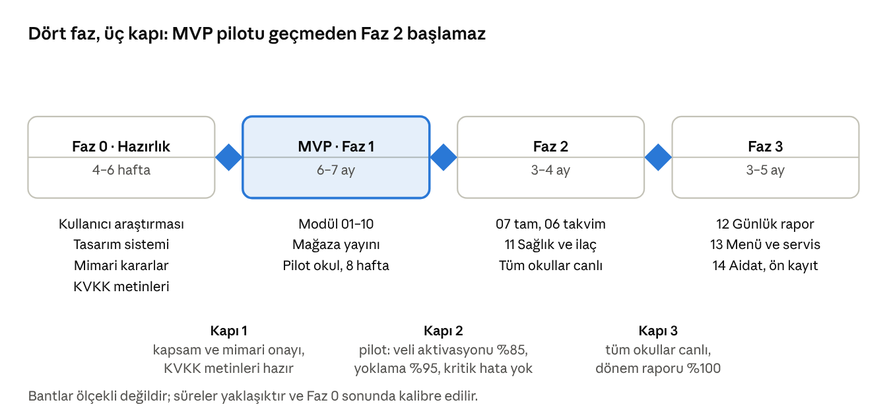

# Yol Haritası

Geliştirme Faz 0 (hazırlık), MVP, Faz 2 ve Faz 3 olarak planlanır; her faz geçişi tanımlı bir kapı kriterine bağlıdır ve MVP tek okulda pilotla doğrulanır.

## Fazlar ve kapılar

Her kapı bir karar toplantısıdır: kriterler karşılanmadıysa sonraki faz başlamaz, düzeltme turu planlanır. Vurgulu bant MVP'dir; pilot okul bu fazın içindedir.

## MVP tanımı

MVP, bir okulda dönem içinde 8 haftalık bir pilot boyunca WhatsApp ve kâğıt olmadan çalışmayı mümkün kılan en küçük kümedir: öğrenci kaydı ve veli hesabı, yoklama, mesajlaşma, duyurular, temel gelişim raporu, mezuniyette erişim kapanışı ve bunları yöneten web paneli.

| Modül | MVP kapsamı | MVP dışında kalan parçası |
| --- | --- | --- |
| 01 Organizasyon | Marka, okul, yıl, okul takvimi (gün türleri), yaş grubu, sınıf, öğretmen atama, ayar katmanları, yıl sonu devir (mezuniyet adımı dahil) | Sınıf bölme ve birleştirme, okul kapatma |
| 02 Kullanıcılar | SMS davet ve kodla giriş, personel parola ve TOTP, cihazlar, rol atama | Biyometrik kilit, sosyal giriş |
| 03 Öğrenci | Kayıt, veliler ve yetki düzeyleri, teslim yetkilileri, rızalar, nakil, Excel aktarımı | Belge arşivi |
| 04 Devamlılık | Yoklama, devamsızlık bildirimi ve mazeret belgesi, otomatik sorgu, teslim kaydı, raporlar, çevrimdışı | Velinin geç alacağını önceden bildirmesi (DV-14) |
| 05 Mesajlaşma | Çocuk, ofis ve iç kanallar, toplu mesaj, şablon, 5 dakikalık geri alma, sessiz saat, acil, müdür inceleme | Belgeyi çocuğun dosyasına kaydetme (MS-13) |
| 06 Duyurular | Kapsamlı duyuru, okudum onayı, zamanlama, onay akışı, okunma raporu | Etkinlik takvimi, izin formu, randevu (gün türleri takvimi 01'de MVP) |
| 07 Gelişim (temel) | Gösterge kataloğu, gözlem notu, dönemlik değerlendirme, veli raporu ve PDF | Onay akışı, portfolyo, görüşme notu, haftalık plan |
| 08 Mezuniyet | Toplu mezuniyet, ayrılış, salt-okunur süre, veri paketi, erişim iptali, saklama politikası, denetim | Veli silme talebi akışı (MVP'de ofis üzerinden) |
| 09 Bildirimler | Anlık bildirim, gelen kutusu, SMS yedeği, özet, tercihler, olay kataloğu; temel rapor seti ve okullar arası karşılaştırma tablosu | Trend görselleri, zamanlanmış raporlar |
| 10 Web paneli | Kabuk, arama, onay kuyruğu, içe aktarma, ayarlar, metin sürümleri, denetim izi, KVKK talepleri | Kaydedilmiş filtreler, öğretmen web erişimi |

**Neden bu küme**

- Velinin günlük dört işini (04, 05, 06, 07) karşılar; bunlar olmadan uygulama WhatsApp'ı ikame edemez.
- 08 ilk günden gereklidir: erişim kapanışı ve saklama kuralı olmadan çocuk verisi toplanmamalıdır.
- 07 temel düzeyde girer; hikayedeki “gelişimi görebilme” ihtiyacını ilk dönemden karşılar, portfolyo ve onay sonraya kalır.
- 12 Günlük rapor sık kullanılan bir özellik olmasına rağmen proje sahibi kararıyla sona bırakıldı (K3); günlük iletişim MVP'de 05 ve 06 ile sağlanır.

## Faz detayları

Süreler yaklaşıktır ve Kaba büyüklük bölümündeki ekip varsayımına dayanır; Faz 0 sonunda yeniden kalibre edilir. Kapsam ve faz değişikliklerine değişiklik kurulu karar verir: proje sahibi, marka yöneticisi, ürün sahibi ve teknik lider; iki haftada bir toplanır, faz kapılarında kriterleri değerlendirir.

| Faz | Süre (yaklaşık) | Modüller ve işler | Çıktılar | Çıkış kriteri |
| --- | --- | --- | --- | --- |
| Faz 0 Hazırlık | 4–6 hafta | 2 okulda kullanıcı araştırması (10 veli, 6 öğretmen, 2 müdür); kapsam onayı; tasarım sistemi ve ana akış prototipleri; mimari karar kayıtları; KVKK metinleri (hukuk); SMS ve bulut sağlayıcı seçimi; mağaza hesapları | Onaylı kapsam, prototip, mimari kararlar, KVKK metinleri | Kapsam ve mimari onayı (proje sahibi); KVKK metinleri hazır; açık soruların en az %80'i kararlaştırılmış |
| MVP (Faz 1) | 6–7 ay | 01–10 (MVP kapsamı); test otomasyonu; güvenlik testi; pilot okul kurulumu ve eğitimi | Mağazalarda yayınlanmış uygulama, web paneli, canlı ortamda 1 okulla 8 haftalık pilot | Pilot okulda veli hesap aktivasyonu en az %85 (ilk 30 gün); yoklama tamamlama en az %95; açık kritik hata yok; KVKK uyum kontrolü geçti |
| Faz 2 | 3–4 ay | 07 tam sürüm; 06 takvim, izin formu, randevu; 11 Sağlık; 09 gelişmiş raporlar; çevrimdışı sağlamlaştırma; 10 öğretmen web erişimi; tüm okullara yaygınlaştırma | Tüm okullar canlı | Tüm okullarda aktivasyon en az %85; dönem raporu kapsaması %100; sağlık verisi rıza oranı ölçüldü |
| Faz 3 | 3–5 ay | 12 Günlük rapor ve medya galerisi; 13 Menü ve servis biniş-iniş; 14 aday modüller (aidat, ön kayıt); servis canlı konum değerlendirmesi | Günlük akış ve ek hizmetler | Medya depolama maliyeti bütçede; aday modüllerin kabulü değişiklik kurulunda (aidat için ödeme sağlayıcı ve muhasebe kararı Faz 3'e giriş koşuludur) |

## Kaba büyüklük ve ekip

Büyüklükler tişört ölçeğiyle verilmiştir ve yaklaşıktır: S 4 kişi-haftadan az, M 4–8, L 8–16, XL 16–24; her büyüklük arka uç, mobil ve web işini birlikte sayar. Rakamlar ekip olgunluğuna göre değişir; Faz 0 sonunda hikaye puanlarıyla yeniden tahmin edilir.

| Modül | Büyüklük | Neden |
| --- | --- | --- |
| 01 Organizasyon | M | CRUD ağırlıklı; devir sihirbazı ve ayar katmanları işin yarısı |
| 02 Kullanıcılar | M | Kod ile giriş, TOTP, cihaz yönetimi, güvenlik olayları |
| 03 Öğrenci | L | Çok ekran, veli yetki düzeyleri, rızalar, içe aktarma, nakil |
| 04 Devamlılık | L | Çevrimdışı giriş, otomatik sorgu akışı, raporlar |
| 05 Mesajlaşma | L | Kanallar (MVP'de kısa aralıklı yenileme), ekler, sessiz saat, denetim ve dışa aktarma |
| 06 Duyurular (MVP) | M | Kapsam çözümleme, okunma takibi, onay akışı |
| 06 Takvim, izin, randevu (Faz 2) | M | Zaman dilimi mekanizması, katılım toplama, izin formu onayı ve PDF |
| 07 Gelişim (temel) | L | Katalog, değerlendirme formu, PDF üretimi |
| 07 Gelişim (tam, Faz 2) | L | Portfolyo medyası, onay, görüşme, plan |
| 08 Mezuniyet | M | Zamanlanmış işler, veri paketi, anonimleştirme, denetim |
| 09 Bildirimler | L | Altyapı: olay kataloğu, kanallar, özetleme, teslim takibi |
| 09 Raporlar (temel) | M | Gece toplama, 8 rapor, dışa aktarma |
| 10 Web paneli | L | Kabuk, arama, onay kuyruğu, metin sürümleri, denetim izi, KVKK talepleri |
| 11 Sağlık (Faz 2) | M | Profil, ilaç zinciri, kaza raporu |
| 12 Günlük rapor ve medya (Faz 3) | L | Toplu giriş arayüzü, medya işleme, rıza modeli |
| 13 Menü ve servis (Faz 3) | L | Menü yayını, alerjen eşleştirme, güzergahlar, çevrimdışı hostes ekranı, bildirimler |

MVP toplamı: altı L modül (03, 04, 05, 07 temel, 09 bildirimler, 10) yaklaşık 72 ve beş M modül (01, 02, 06, 08, 09 raporlar) yaklaşık 30 kişi-hafta, toplam yaklaşık 100 kişi-hafta geliştirme; test, altyapı, mağaza süreçleri ve pilot desteğiyle 130–150 kişi-hafta. Kapasite: beş geliştirici × 26 hafta ≈ 130 kişi-hafta; aşağıdaki ekiple bu 6–7 aya karşılık gelir.

**Önerilen ekip**

| Rol | Sayı | Not |
| --- | --- | --- |
| Ürün sahibi / iş analisti | 1 | Okullarla bağ, kabul testleri |
| UX ve UI tasarımcı | 1 | Faz 0'da tam, sonra yarı zamanlı |
| Arka uç geliştirici | 2 | API, bildirim altyapısı, raporlar |
| Mobil geliştirici (Flutter) | 2 | Veli ve öğretmen modları, çevrimdışı |
| Web geliştirici (Vue) | 1 | Yönetim paneli |
| Test ve otomasyon | 1 | Yetki ve KVKK testleri öncelikli |
| DevOps | Yarı zamanlı | Ortamlar, CI/CD, izleme, yedekleme |
| Hukuk danışmanı (KVKK) | Yarı zamanlı | Metinler, saklama süreleri, sözleşmeler |

## Pilot ve yaygınlaştırma planı

Pilot tek okulda 8 hafta sürer; başarı ölçütleri Genel Bakış'taki tabloya göre haftalık izlenir ve yaygınlaştırma kararı pilot sonunda verilir.

1. Pilot okul seçimi: orta büyüklükte (4–6 sınıf), yönetimi istekli, veli profili markayı temsil eden bir okul.
2. Pilot öncesi (2 hafta): Excel'den veri aktarımı, veli bilgilendirme toplantısı ve aydınlatma metni, öğretmenlere 2 saatlik eğitim, ofise panel eğitimi, destek hattı.
3. Pilot (8 hafta): ilk 2 hafta WhatsApp ile paralel, sonra yalnızca uygulama; haftalık geri bildirim toplantısı; hata ve istek listesi.
4. Pilot çıkışı: ölçütler karşılandıysa yaygınlaştırma; karşılanmadıysa 4 haftalık düzeltme turu ve yeniden ölçüm.
5. Yaygınlaştırma: okul başına 2 hafta aralıkla; her okulda bir “uygulama şampiyonu” öğretmen; marka duyurusu ve veli videoları (3 dakikalık).
6. Eski kanalların kapatılması: her okulda canlıya geçişin 4 hafta sonrasında WhatsApp grupları kapanır (yönetim kararı, duyuruyla).
7. Destek modeli: birinci seviye okul ofisi, ikinci seviye teknik ekip; hedef yanıt süresi kritik sorunda 2 saat, diğerlerinde 1 iş günü.
8. Ölçüm ve geri bildirim: aktivasyon, yoklama tamamlama ve mesaj yanıt süresi haftalık; pilot sonunda veli ve öğretmen memnuniyet anketi (10 soru).
