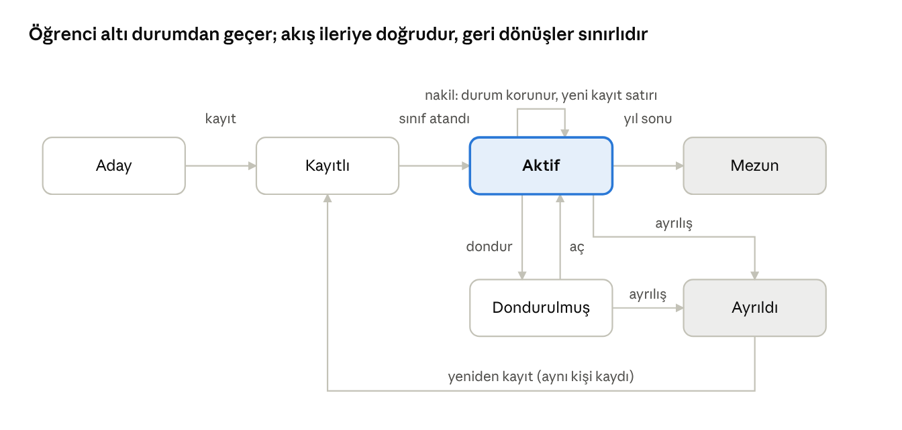

# 03 Öğrenci Yönetimi ve Yaşam Döngüsü

Her öğrenci tek bir kişi kaydına bağlı yıllık kayıtlarla izlenir; durum makinesi (aday → kayıtlı → aktif → dondurulmuş → mezun / ayrıldı) tüm erişim kurallarını belirler.

## Amaç, kapsam ve aktörler

Modül, çocuğun okulla ilişkisinin tamamını tek kayıtta tutar: kim olduğu, hangi okul ve sınıfta olduğu, hangi velilerin onu görebildiği, kimin teslim alabileceği ve bugün hangi durumda olduğu. Yoklama, mesaj, gelişim ve mezuniyet modülleri bu kayda bağlanır.

**Kapsam içi**

- Öğrenci kişi kaydı (kimlik, doğum tarihi, fotoğraf, temel bilgiler) ve eğitim yılı bazlı kayıt (enrollment) ayrımı.
- Veli bağlantıları: en az bir, en çok dört yetkili yetişkin; her biri için yakınlık ve yetki düzeyi.
- Teslim alma yetkilileri (fotoğraf ve kimlik bilgisiyle) ve acil durum kişileri.
- Sınıf ataması, sınıf değişikliği, marka içi okullar arası nakil.
- Durum yaşam döngüsü: aday → kayıtlı → aktif → dondurulmuş → mezun / ayrıldı.
- Temel sağlık ve diyet işaretleri (alerji rozeti) ve rıza kayıtları (fotoğraf, sağlık, iletişim).
- Excel'den toplu öğrenci ve veli aktarımı (ilk geçiş için).

**Kapsam dışı**

- Ön kayıt ve bekleme listesi (14 İleri Faz).
- Aidat ve sözleşme (14 İleri Faz).
- Ayrıntılı sağlık dosyası ve ilaç uygulama (11 Sağlık).
- Mezuniyet sonrası saklama kuralları (08 Mezuniyet).

**Aktörler**

| Aktör | Modüldeki işi |
| --- | --- |
| Okul sekreteri / ofis | Kaydı açar, veli ve teslim yetkililerini girer, sınıfa atar, belgeleri yükler |
| Okul müdürü | Nakil ve ayrılışı onaylar, kapasite ve sınıf dengesini izler |
| Marka yöneticisi | Standart alanları tanımlar; okullar arası nakli gerektiğinde marka düzeyinden başlatır veya onaylar (Roller ve Yetkiler, özel durumlar) |
| Öğretmen | Sınıf listesini ve çocuk profilini (alerji, teslim yetkilileri, veli iletişimi) görür; kimlik alanlarını değiştiremez |
| Veli | Kendi çocuğunun profilini görür, iletişim bilgisini ve acil kişileri günceller, rızaları yönetir |

## Kullanıcı hikayeleri

| ID | Rol | Hikaye | Öncelik | Faz |
| --- | --- | --- | --- | --- |
| OG-01 | Ofis | Yeni bir çocuğu kimlik, doğum tarihi ve veli bilgileriyle 3 dakikada kaydetmek istiyorum, böylece kayıt günü kuyruk oluşmasın. | Must | MVP |
| OG-02 | Ofis | Kayıt sırasında veliyi SMS ile davet etmek istiyorum, böylece veli ilk gün uygulamaya girsin. | Must | MVP |
| OG-03 | Ofis | Çocuğa ikinci veli ve teslim yetkilisi eklemek istiyorum, böylece teslimde kimin yetkili olduğu belli olsun. | Must | MVP |
| OG-04 | Ofis | Mevcut Excel listemizi tek seferde içe aktarmak istiyorum, böylece ilk geçişte elle giriş yapmayalım. | Should | MVP |
| OG-05 | Okul müdürü | Çocuğu başka bir sınıfa veya markanın başka okuluna aktarmak istiyorum, böylece geçmişi kaybolmadan yeni yerinde devam etsin. | Must | MVP |
| OG-06 | Ofis | Bir velinin erişimini mahkeme kararı gereği müdür onayıyla kısıtlamak istiyorum, böylece çocuğun bilgisi yetkisiz kişiye gitmesin. | Must | MVP |
| OG-07 | Öğretmen | Sınıf listemde her çocuğun fotoğrafını, alerjisini ve teslim yetkililerini görmek istiyorum, böylece teslimde ve yemekte hata yapmayayım. | Must | MVP |
| OG-08 | Veli | Çocuğumun profilinde telefonumu, adresimi ve acil durum kişisini güncellemek istiyorum, böylece okul bana ulaşabilsin. | Should | MVP |
| OG-09 | Veli | Fotoğraf ve sağlık verisi rızalarımı görüp değiştirmek istiyorum, böylece neyin paylaşıldığını ben belirleyeyim. | Must | MVP |
| OG-10 | Ofis | Kaydı dondurmak (uzun hastalık, yurt dışı) ve sonra açmak istiyorum, böylece çocuk sınıf listesinde yer tutmasın ama kaybolmasın. | Should | MVP |
| OG-11 | Marka yöneticisi | Tüm okullardaki kayıtlı ve aday öğrenci sayılarını sınıf doluluğuyla görmek istiyorum, böylece kapasite kararı vereyim. | Should | MVP |
| OG-12 | Ofis | Kardeşleri birbirine bağlamak istiyorum, böylece veli tek hesaptan ikisini de görsün ve duyurular tekrar gitmesin. | Should | MVP |
| OG-13 | Ofis | Kayıt belgelerini (sözleşme, aşı kartı, kimlik fotokopisi) yüklemek istiyorum, böylece öğrenci dosyası dijital olsun. | Could | Faz 2 |
| OG-14 | Okul müdürü | Yeni eğitim yılında tüm sınıfı bir üst yaş grubuna toplu taşımak istiyorum, böylece Eylül'de tek tek atama yapmayayım (01 devir sihirbazı; ofis önizlemeyi hazırlar). | Must | MVP |

## İş kuralları ve işlevsel gereksinimler

**Kayıt ve kimlik**

1. Bir çocuk için tek kişi kaydı vardır; her eğitim yılı için ayrı bir kayıt (enrollment) satırı açılır. Nakil ve yeniden kayıt aynı kişi kaydına bağlanır.
2. Zorunlu alanlar: ad, soyad, doğum tarihi, en az bir veli, okul, eğitim yılı. T.C. kimlik numarası isteğe bağlıdır, yalnızca ofis görür ve maskeli gösterilir.
3. Doğum tarihi yaş grubu önerisini belirler; ofis öneriyi değiştirebilir.
4. Kayıt sınıfsız açılabilir (durum: kayıtlı); sınıfa atanıp eğitim yılı başlayınca aktif olur.

**Veli ve teslim yetkisi**

5. Her çocuğun en az bir tam yetkili velisi olmalıdır. Yetki düzeyleri: tam (her şeyi görür, rıza verir, teslim alır), sınırlı (görür, mesaj yazar, rıza veremez), kısıtlı (yalnızca ofisin açtığı başlıkları görür; mahkeme kararı gibi durumlar için).
6. Kısıtlı işaretini ofis mahkeme kararıyla girer, okul müdürü onaylar; işaretlendiği anda hiçbir içerik ve bildirim gitmez, ofis açılacak başlıkları tek tek belirler.
7. Teslim yetkilisi listesinde ad, telefon, yakınlık ve fotoğraf bulunur; öğretmen teslimde listeden seçer. Listede olmayan kişiye teslim yalnızca tam yetkili velinin uygulama içinden verdiği tek seferlik onayla yapılır.
8. Veli telefonu değiştiğinde yeni numara SMS ile doğrulanır; doğrulanana kadar hesap eski numarada kalır.
9. Kardeşler aynı veli hesabına bağlanır; veli uygulamada çocuklar arasında geçiş yapar.

**Sınıf, nakil ve durumlar**

10. Bir çocuk aynı anda yalnızca bir aktif sınıfta olabilir. Sınıf değişikliği tarih alır; geçmiş yoklama ve raporlar eski sınıfta kalır.
11. Marka içi nakil: kaynak okulun müdürü başlatır, hedef okulun müdürü kabul eder; marka yöneticisi gerektiğinde iki adımı da marka düzeyinden yapar (denetim izinde işaretlenir). Kabul tarihinde hedef okulda yeni bir kayıt satırı açılır, eski kayıt bitiş tarihi ve “nakil” ayrılış nedeniyle kapanır; kişi kaydı ve tarihçe korunur; veli bilgilendirilir, yeni öğretmen profile erişir, eski öğretmenin erişimi kalkar.
12. Durum geçişleri: aday → kayıtlı → aktif → (dondurulmuş ⇄ aktif) → mezun veya ayrıldı; kayıtlı → ayrıldı (hiç başlamayan çocuk) da mümkündür. Geriye dönüş yalnızca dondurulmuş → aktif, mezun → aktif (08'deki 72 saatlik geri alma) ve mezun veya ayrıldı → kayıtlı (anonimleştirme öncesi yeniden kayıt, 08) için mümkündür.
13. Dondurulmuş çocuk sınıf listesinde görünmez, yoklamaya girmez; velinin erişimi salt-okunur olur.
14. Mezun ve ayrıldı durumlarının erişim ve saklama sonuçları 08 Mezuniyet ve Ayrılış modülünde tanımlıdır; bu modül yalnızca durumu değiştirir ve olayı yayınlar.

**Rıza ve hassas veri**

15. Rıza kayıtları çocuk bazındadır ve tam yetkili veli verir: fotoğraf (yalnız kendi velisi / sınıf albümü / okul tanıtımı), sağlık verisi işleme, iletişim tercihleri. Kayıt anında kâğıt üzerinde alınan rızayı ofis “kâğıt form” kaynağıyla girer; veli ilk girişte görür ve değiştirebilir. Her değişiklik tarih, kullanıcı, kaynak ve metin sürümüyle denetim izine yazılır.
16. Alerji veya diyet kısıtı girildiğinde çocuğun adının yanında rozet görünür (sınıf listesi, yoklama, menü).
17. Kimlik numarası, adres ve sağlık ayrıntısı yalnızca yetkili rollere döner; öğretmen API'sinde yalnızca güvenlik için gerekli işaretler (alerji, diyet, acil durum) bulunur.

**Toplu aktarım**

18. Excel şablonu sütunları: ad, soyad, doğum tarihi, okul, yaş grubu, sınıf, veli 1 (ad, soyad, telefon, yakınlık), veli 2 (aynı alanlar), isteğe bağlı yetki düzeyi sütunu (boşsa veli 1 tam yetkili, veli 2 sınırlı). Önizleme hatalı satırları gösterir; hatasız satırlar aktarılır.
19. Aynı ad, soyad ve doğum tarihi varsa olası mükerrer uyarısı verilir; birleştirme ofisin kararıdır.

## Süreç akışı

Gri dolgulu kutular bitiş durumlarıdır; velinin erişiminin nasıl kapandığı 08 Mezuniyet ve Ayrılış'ta tanımlıdır. Nakil durumu değiştirmez, aynı kişi kaydına hedef okulda yeni bir kayıt satırı açar. Çizim ana geçişleri gösterir; mezun → aktif (72 saatlik geri alma), kayıtlı → ayrıldı (hiç başlamayan çocuk) ve mezun → kayıtlı (yeniden kayıt) geçişleri kural 12'de tanımlıdır.

## Veri, ekranlar ve bildirimler

**Varlıklar**

| Varlık | Anahtar alanlar | Not |
| --- | --- | --- |
| Öğrenci (kişi) | id, marka, ad, soyad, doğum tarihi, cinsiyet, fotoğraf, kimlik no (maskeli), adres, notlar | Okuldan bağımsız, kalıcı kayıt |
| Kayıt (enrollment) | id, öğrenci, okul, eğitim yılı, yaş grubu, sınıf, durum, başlangıç, bitiş, ayrılış nedeni | Yılda bir satır; nakilde yeni satır |
| Veli bağlantısı | öğrenci, kullanıcı, yakınlık, yetki düzeyi (tam / sınırlı / kısıtlı), birincil mi | Bir veli birden çok çocuğa bağlanır |
| Teslim yetkilisi | öğrenci, ad, telefon, yakınlık, fotoğraf, geçerlilik aralığı | Veliler listede hazır gelir |
| Acil kişi | öğrenci, ad, telefon, yakınlık, sıra | Sırayla aranır |
| Rıza | öğrenci, tür, değer, veren veli, kaynak (uygulama / kâğıt form), tarih, metin sürümü | Değişiklik geçmişi tutulur |
| Sağlık işareti | öğrenci, tür (alerji / diyet / kronik), şiddet, açıklama | Ayrıntı 11 Sağlık'ta |
| Belge | öğrenci, tür, dosya, yükleyen, tarih | Faz 2 |
| Durum geçişi (olay) | kayıt, eski durum, yeni durum, tarih, yapan, neden | 08 Mezuniyet bu olayı dinler |

**Ekranlar**

| Ekran | Platform | Rol | İçerik |
| --- | --- | --- | --- |
| Öğrenci listesi ve arama | Web | Ofis, yöneticiler | Filtre: okul, sınıf, durum, yaş grubu; toplu işlem |
| Öğrenci kartı | Web | Ofis, yöneticiler | Sekmeler: kimlik, veliler ve teslim, kayıt geçmişi, rızalar, belgeler, sağlık işaretleri |
| Yeni kayıt sihirbazı | Web | Ofis | 3 adım: çocuk, veliler, sınıf ve kâğıt rıza formu girişi; veli daveti gönder |
| Toplu içe aktarma | Web | Ofis, yöneticiler | Şablon indir, yükle, önizle, aktar |
| Nakil ekranı | Web | Okul müdürü, marka yöneticisi | Kaynak, hedef, tarih, onay |
| Sınıf listesi | Mobil | Öğretmen | Fotoğraf, ad, rozetler; dokununca çocuk profili |
| Çocuk profili (öğretmen görünümü) | Mobil | Öğretmen | Veliler ve telefonları, teslim yetkilileri, alerji, acil kişiler |
| Çocuğum | Mobil | Veli | Profil, veliler, acil kişiler, rızalar; kardeşler arası geçiş |

**Bildirimler**

| Olay | Alıcı | Kanal | Zamanlama |
| --- | --- | --- | --- |
| Kayıt açıldı, veli davet edildi | Veli | SMS (davet bağlantısı) | Anında |
| Sınıf atandı veya değişti | Veli, yeni ve eski öğretmen | Anlık bildirim | Anında |
| Nakil kabul edildi | Veli, iki okulun müdürü | Anlık bildirim, e-posta | Anında |
| Veli yetkisi kısıtlandı | Okul müdürü (onay), tam yetkili veli | Uygulama içi | Anında |
| Rıza değişti | Ofis | Uygulama içi | Günlük özet |
| Kayıt donduruldu veya açıldı | Veli, öğretmen | Anlık bildirim | Anında |

## Uç durumlar, kabul kriterleri ve açık sorular

**Uç durumlar**

- Boşanmış veliler: ikisi de tam yetkili olabilir; mahkeme kararıyla biri kısıtlı yapılır. Kısıtlı veli çocuğun varlığını görür ama içerik görmez; ofis isterse bağlantıyı tamamen kaldırır.
- Aynı velinin iki okulda çocuğu: tek hesap, iki okul bağlamı; duyurular okul bazında ayrışır.
- Velinin akıllı telefonu yok: ikinci veli veya SMS özetleri (09 Bildirimler) devreye girer; ofis “uygulama kullanmıyor” işaretler, kritik bilgiler SMS ile gider.
- Yıl ortasında gelen çocuk: kayıt tarihi önceki raporları etkilemez; devam oranı kayıt tarihinden hesaplanır.
- Aynı çocuğun iki kez kaydedilmesi: ofis kayıtları birleştirir; yoklama ve mesaj geçmişi hedef kayda taşınır.
- Teslimde listede olmayan kişi: öğretmen tek seferlik onay ister; veli 5 dakika içinde onaylamazsa teslim yapılmaz ve ofis aranır.
- Nakil sırasında açık mesaj kanalları: eski öğretmenin kanalı salt-okunur arşive düşer; yeni kanal hedef okulda açılır.

**Kabul kriterleri**

- Ofis yeni bir çocuğu iki veliyle birlikte 3 dakikada kaydedebilir; veli davet SMS'i 1 dakika içinde ulaşır.
- Öğretmen API'si kimlik numarası, adres ve sağlık ayrıntısı döndürmez (otomatik test).
- Kısıtlı veli, kısıtlama anından itibaren hiçbir yeni bildirim ve içerik almaz (otomatik test).
- Nakil sonrası kişi kaydının geçmişi (yoklama, gelişim raporu) hedef okuldan görülür; eski okulun öğretmeni artık göremez.
- 500 satırlık Excel aktarımı hatalı satırları satır numarasıyla raporlar ve 2 dakikadan kısa sürer.

**Açık sorular**

- [ ] T.C. kimlik numarası zorunlu tutulacak mı? (MEB kayıt yükümlülüğü doğrulanmalı; zorunluysa şifreli saklanır ve yalnızca ofis görür; S18)
- [ ] Teslimde fotoğraflı doğrulama yeterli mi, tek seferlik kod da istenecek mi?
- [ ] Kısıtlı veli durumunda mahkeme kararı belgesi sistemde saklanacak mı?
- [ ] Marka dışı bir kuruma nakilde veri nasıl aktarılacak? (varsayılan: PDF özet ve veri paketi, 08 Mezuniyet)
