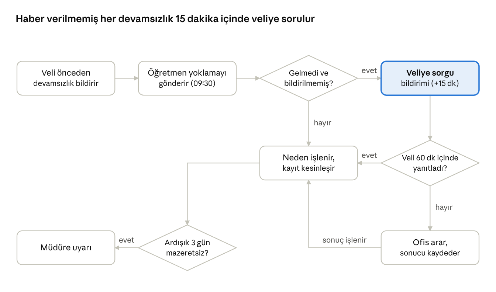

# 04 Devamlılık Takibi

Öğretmen her gün belirlenen saate kadar sınıfının yoklamasını alır; haber verilmemiş devamsızlık veliye otomatik sorulur, ardışık devamsızlık yönetime iletilir.

## Amaç, kapsam ve aktörler

Modül her okul gününde her aktif çocuğun okulda olup olmadığını, ne zaman geldiğini ve kime teslim edildiğini kayıt altına alır. Haber verilmemiş devamsızlığı aynı sabah veliye sorar; yönetime devam oranlarını okul, sınıf ve çocuk bazında gösterir.

**Kapsam içi**

- Sınıf bazlı günlük yoklama (toplu “hepsi geldi” + istisnalar), geç geliş ve erken ayrılış kaydı.
- Velinin önceden devamsızlık bildirmesi (neden, süre, isteğe bağlı belge).
- Haber verilmemiş devamsızlıkta otomatik veli sorgusu ve yanıt toplama.
- Teslim alma kaydı (kim, saat) ve geç alma takibi.
- Ardışık devamsızlık ve düşük devam oranı uyarıları.
- Devam raporları ve dışa aktarma (CSV, PDF).
- Çevrimdışı yoklama girişi ve senkronizasyon.

**Kapsam dışı**

- Servis biniş-iniş kaydı (13 Yemek Menüsü ve Servis).
- Personel devam ve vardiya takibi (14 İleri Faz, İK).
- Aidatla ilişkili devamsızlık kesintileri (14 İleri Faz).
- MEB e-Okul devamsızlık bildirimi: bilinen resmi entegrasyon yok; dışa aktarma dosyasıyla (14 İleri Faz, doğrulanmalı).

**Aktörler**

| Aktör | Modüldeki işi |
| --- | --- |
| Öğretmen / yardımcı öğretmen | Yoklamayı alır, geç geliş ve teslim kaydeder, veli yanıtlarını görür |
| Veli | Devamsızlık bildirir, otomatik sorguyu yanıtlar, çocuğunun devam geçmişini görür |
| Ofis | Mazeret belgelerini onaylar, kilitli yoklamayı düzeltir |
| Okul müdürü | Devam raporlarını izler, ardışık devamsızlık uyarılarını ele alır, yoklama saatini ayarlar |
| Marka yöneticisi | Okullar arası devam karşılaştırması |

## Kullanıcı hikayeleri

| ID | Rol | Hikaye | Öncelik | Faz |
| --- | --- | --- | --- | --- |
| DV-01 | Öğretmen | Sabah sınıf listesinde “hepsi geldi” deyip yalnızca gelmeyenleri işaretlemek istiyorum, böylece yoklama 1 dakikada bitsin. | Must | MVP |
| DV-02 | Öğretmen | Geç gelen çocuğu saatiyle işaretlemek istiyorum, böylece sabah devamsız görünen çocuk sonradan düzelsin. | Must | MVP |
| DV-03 | Öğretmen | Teslimde çocuğu kimin aldığını listeden seçmek istiyorum, böylece yetkisiz teslim olmasın ve kayıt kalsın. | Must | MVP |
| DV-04 | Veli | Çocuğum hasta olduğunda uygulamadan iki dokunuşla bildirmek istiyorum, böylece öğretmeni aramam gerekmesin. | Must | MVP |
| DV-05 | Veli | Çocuğum haber vermeden okula gelmediğinde bana sorulmasını istiyorum, böylece bir yanlışlık varsa hemen fark edeyim. | Must | MVP |
| DV-06 | Veli | Çocuğumun aylık devam geçmişini görmek istiyorum, böylece devamsızlık nedenlerini takip edeyim. | Should | MVP |
| DV-07 | Okul müdürü | Yoklama saatinden sonra hangi sınıfın yoklamasının girilmediğini görmek istiyorum, böylece öğretmeni uyarayım. | Must | MVP |
| DV-08 | Okul müdürü | 3 gün üst üste gelmeyen çocuk için uyarı almak istiyorum, böylece veliyle görüşeyim. | Should | MVP |
| DV-09 | Okul müdürü | Sınıf ve okul bazında aylık devam oranı raporu almak istiyorum, böylece yönetim toplantısında kullanayım. | Should | MVP |
| DV-10 | Ofis | Veli mazeret belgesini uygulamadan yüklesin, ben onaylayayım istiyorum, böylece kâğıt rapor toplamayayım. | Should | MVP |
| DV-11 | Öğretmen | İnternet yokken de yoklama girmek istiyorum, böylece bahçede veya bodrumda da çalışayım. | Should | MVP |
| DV-12 | Marka yöneticisi | Okulları devam oranına göre karşılaştırmak istiyorum, böylece sorunlu okulu erken göreyim. | Should | MVP |
| DV-13 | Öğretmen | Erken alınan çocuğu saatiyle işaretlemek istiyorum, böylece öğleden sonraki etkinlik listesi doğru olsun. | Should | MVP |
| DV-14 | Veli | Geç alacağımı okula bildirmek istiyorum, böylece öğretmen beklemesi gerektiğini bilsin. | Could | Faz 2 |

## İş kuralları ve işlevsel gereksinimler

**Yoklama**

1. Yoklama günleri 01'deki okul takviminde “okul günü” türündeki günlerdir; tatil ve kapalı günlerde yoklama açılmaz.
2. Her sınıf için günde bir yoklama kaydı vardır; sorumlu veya yardımcı öğretmen girer, ofis düzeltebilir. Her değişiklik kim ve ne zaman bilgisiyle loglanır.
3. Yoklama saati okul ayarıdır (varsayılan 09:30). Saat geçince girilmemiş sınıflar için öğretmene hatırlatma, 30 dakika sonra müdüre uyarı gider.
4. Durumlar: Geldi, Geç geldi (saat), Gelmedi – mazeretli, Gelmedi – mazeretsiz. Erken ayrılış ayrı bir durum değildir; Geldi veya Geç geldi kaydına eklenen ayrılış saatidir. Dondurulmuş çocuk listede yer almaz. Varsayılan durum Geldi'dir; öğretmen yalnızca istisnaları işaretler.
5. Veli önceden bildirim yaptıysa çocuk yoklamada “bildirildi” etiketiyle Gelmedi – mazeretli olarak önceden işaretli gelir; öğretmen değiştirebilir.
6. Yoklama öğretmen “gönder” dediğinde kesinleşir; gün içinde geç geliş ve erken ayrılış eklenebilir. Kayıt okulun yoklama kilit saatinde (okul ayarı, varsayılan 18:00) kilitlenir; sonrasını yalnızca ofis, neden girerek düzeltir.

**Veli bildirimi ve otomatik sorgu**

7. Veli devamsızlığı en çok 10 gün ileriye kadar bildirebilir; nedenler: hastalık, tatil, aile, diğer (açıklama). Belge yükleme isteğe bağlıdır.
8. Bildirim olmadan Gelmedi işaretlenen her çocuk için yoklama kesinleştikten 15 dakika sonra tam ve sınırlı yetkili velilere anlık bildirim gider: “Ali bugün okula gelmedi. Bilgi verir misiniz?” Veli tek dokunuşla neden seçer; yanıt yoklamaya işlenir.
9. Veli 60 dakika içinde yanıt vermezse aynı soru SMS ile gönderilir ve ofise “ulaşılamadı” uyarısı düşer; ofis telefonla arar ve sonucu kaydeder. Sorgu okul saatleri içinde üretildiği için sessiz saat kuralına girmez.
10. Veli yanıtı çocuğun okulda olduğunu söylüyorsa öğretmene düzeltme isteği gider.

**Teslim ve geç alma**

11. Teslimde öğretmen çocuğun teslim yetkilisi listesinden kişiyi seçer; saat kendiliğinden kaydedilir. Listede olmayan kişi için 03 Öğrenci kuralı 7 uygulanır.
12. Kapanış saatinden (okul ayarı) sonra teslim edilmemiş çocuk “geç alma” olarak listelenir; veliye hatırlatma gider, ofis kaydı görür.

**Uyarılar ve raporlar**

13. Ardışık 3 okul günü mazeretsiz devamsızlıkta müdüre uyarı, 5 günde ofise görüşme görevi düşer. Eşikler okul ayarıdır.
14. Aylık devam oranı = (Geldi + Geç geldi günleri) / okul günleri; dondurulmuş günler paydaya girmez. Çocuk, sınıf, okul ve marka düzeyinde hesaplanır.
15. Raporlar: günlük yoklama durumu (girilmemiş sınıflar), çocuk devam geçmişi, sınıf ve okul aylık oranları, neden dağılımı, geç geliş ve geç alma listeleri; CSV ve PDF dışa aktarma.

**Çevrimdışı**

16. Yoklama ekranı sınıf listesini önbellekler; bağlantı yokken girilen yoklama cihazda saklanır, bağlantı gelince gönderilir. Kesinleşme saati gönderim saati değil, giriş saatidir.
17. Aynı sınıf için iki cihazdan çakışan girişte son gönderilen kazanır; önceki giriş değişiklik geçmişinde kalır ve iki öğretmene de bildirilir.

## Süreç akışı

Velinin önceden bildirdiği devamsızlık yoklamada hazır işaretli gelir ve sorgu üretmez; yalnızca bildirilmemiş devamsızlık veliye sorulur, yanıtsız kalırsa ofise düşer. Ardışık devamsızlık eşiği her kesinleşen yoklamadan sonra denetlenir.

## Veri, ekranlar ve bildirimler

**Varlıklar**

| Varlık | Anahtar alanlar | Not |
| --- | --- | --- |
| Yoklama günü (sınıf) | sınıf, tarih, durum (açık / kesinleşti / kilitli), giren, kesinleşme saati | Günde bir |
| Yoklama kaydı (çocuk) | yoklama günü, kayıt (enrollment), durum, geliş saati, ayrılış saati, neden, kaynak (öğretmen / veli bildirimi / veli yanıtı / ofis) | Değişiklik geçmişi tutulur |
| Devamsızlık bildirimi | kayıt, tarih aralığı, neden, açıklama, belge, bildiren veli, ofis onayı | Yoklamaya ön işaret olur |
| Teslim kaydı | kayıt, tarih, teslim alan (teslim yetkilisi), saat, teslim eden öğretmen, tek seferlik onay | Teslim yetkilisi listesi 03'te |
| Uyarı | tür (girilmemiş / ardışık / ulaşılamadı / geç alma), hedef, durum, kapatan | Kapatan ve sonuç kaydedilir |
| Okul yoklama ayarı | okul, yoklama saati, yoklama kilit saati, kapanış saati, ardışık eşikler, otomatik sorgu açık mı | 01 ayar katmanıyla yönetilir |

**Ekranlar**

| Ekran | Platform | Rol | İçerik |
| --- | --- | --- | --- |
| Bugünkü yoklama | Mobil | Öğretmen | Sınıf listesi, “hepsi geldi”, istisna işaretleme, gönder; bildirilen devamsızlıklar önceden işaretli |
| Çocuğun günü | Mobil | Öğretmen | Geç geliş, erken ayrılış, teslim alan, not |
| Teslim ekranı | Mobil | Öğretmen | Çocuk seç, yetkili listesinden kişi seç, onayla |
| Devamsızlık bildir | Mobil | Veli | Tarih(ler), neden, açıklama, belge |
| Devamsızlık sorgusu | Mobil (bildirimden açılır) | Veli | Tek dokunuşla neden seçimi |
| Devam geçmişi | Mobil | Veli | Aylık takvim görünümü, nedenler, oran |
| Yoklama paneli | Web, mobil özet | Okul müdürü | Girilmemiş sınıflar, bugünkü devamsızlar, uyarılar |
| Devam raporları | Web | Okul müdürü, marka yöneticisi | Sınıf, okul ve marka oranları, dönem karşılaştırma, dışa aktarma |
| Yoklama düzeltme | Web | Ofis | Kilitli kaydı neden girerek düzeltme |

**Bildirimler**

| Olay | Alıcı | Kanal | Zamanlama |
| --- | --- | --- | --- |
| Yoklama saati geçti, sınıf girilmedi | Öğretmen; 30 dk sonra müdür | Anlık bildirim | Yoklama saatinde |
| Haber verilmemiş devamsızlık | Tam ve sınırlı veliler | Anlık bildirim (yanıt butonlu); 60 dk içinde yanıt yoksa SMS | Kesinleşmeden 15 dk sonra |
| Veli devamsızlık bildirdi | Sınıf öğretmenleri | Uygulama içi | Anında |
| Veliye ulaşılamadı | Ofis | Uygulama içi uyarı | 60 dk sonra |
| Ardışık devamsızlık eşiği | Okul müdürü, ofis | Uygulama içi, e-posta | Yoklama kesinleşince |
| Geç alma | Veli, ofis | Anlık bildirim | Kapanış saatinde |
| Çocuk teslim edildi | Veli | Anlık bildirim | Teslim anında; veli tercihine bağlı |

## Uç durumlar, kabul kriterleri ve açık sorular

**Uç durumlar**

- Yarım gün ve etkinlik günleri: gün türü yoklamayı etkilemez; yalnızca kapalı günlerde yoklama açılmaz.
- Çocuk sabah geldi, öğlen hastalanıp gitti: Geldi + erken ayrılış saati; devam oranında tam gün sayılır (okul ayarıyla yarım gün seçilebilir).
- Öğretmen izinli: müdür geçici sınıf ataması yapar; geçici öğretmen o günlerde yoklama girebilir.
- Yoklama yanlışlıkla gönderildi: kilit saatine kadar öğretmen düzeltir; veliye giden sorgu “düzeltildi” bilgisiyle kapatılır.
- Veli iki çocuğu için bildirim yapıyor: tek ekranda birden çok çocuk seçilir.
- Bildirilen aralık tatile denk geliyor: tatil günleri atlanır, yalnızca okul günleri işaretlenir.
- Nakil günü: kayıt geçişi yoklama gününden önce yapılmalıdır; aynı gün nakilde eski sınıfın yoklaması geçerlidir.

**Kabul kriterleri**

- 20 kişilik sınıfta herkes geldiyse yoklama 3 dokunuşla, 2 devamsız varsa 6 dokunuşla gönderilir.
- Haber verilmemiş devamsızlık sorgusu kesinleşmeden 15 dakika sonra gönderilir ve 1 dakika içinde velinin telefonuna ulaşır (test ortamında ölçülür).
- Çevrimdışı girilen yoklama bağlantı gelince 1 dakika içinde sunucuya ulaşır ve giriş saatini korur.
- Kilitli yoklama yalnızca ofis tarafından, neden girilerek düzeltilebilir; düzeltme geçmişi raporda görünür.
- Aylık devam raporu okul ve sınıf bazında CSV olarak 10 saniyeden kısa sürede üretilir.

**Açık sorular**

- [ ] Varsayılan yoklama saati 09:30 uygun mu? Okul okul farklı olacak mı?
- [ ] Teslim bildirimi veliye her gün gitsin mi, yoksa yalnızca alışılmadık kişide mi?
- [ ] Ardışık devamsızlık eşiği (3 gün) ve müdüre giden kanal (e-posta veya anlık bildirim) onaylanmalı.
- [ ] Mazeret belgesi (doktor raporu) sağlık verisi sayılır; saklama süresi ve erişimi KVKK görüşüne göre belirlenmeli.
- [ ] Devam oranı aidat veya MEB raporlarına girecek mi? Hesap kuralı buna göre sabitlenir.
