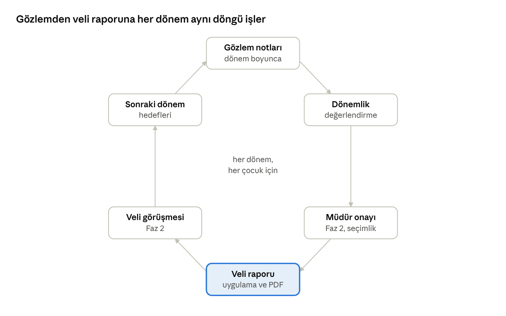

# 07 Gelişim Takibi

Gelişim takibi gözlem notu, dönemlik değerlendirme ve veli raporu döngüsüyle işler; gösterge kataloğu MEB okul öncesi programının gelişim alanlarına göre yapılandırılır (program sürümü doğrulanmalı, S10).

## Amaç, kapsam ve aktörler

Modül öğretmenin her çocuk için gözlem notu tutmasını, dönem sonunda yapılandırılmış bir değerlendirme yapmasını ve bunu veliyle paylaşmasını sağlar. MVP'de gözlem notu ve dönemlik rapor vardır; portfolyo, onay akışı, görüşme notları ve haftalık eğitim planı Faz 2'dedir.

**Kapsam içi**

- Gösterge kataloğu: gelişim alanı ve göstergeler, yaş grubuna göre; marka düzeyinde yönetilir, MEB Okul Öncesi Eğitim Programı'ndan uyarlanır (güncel programla doğrulanmalı).
- Gözlem notu: hızlı, alan etiketli, tek çocuk veya grup için; isteğe bağlı fotoğraf (Faz 2).
- Dönemlik değerlendirme formu: her gösterge için ölçek, alan bazında serbest metin, genel yorum, sonraki dönem hedefleri.
- Dönem raporu (veli raporu): yayınlanınca uygulamada görünür, PDF indirilir; dönemler arası karşılaştırma.
- Onay akışı (Faz 2): öğretmen taslağı, müdür onayı, yayın.
- Portfolyo (Faz 2): çocuğun çalışma örnekleri (fotoğraf, ses, kısa video), gösterge etiketli.
- Veli görüşme notları (Faz 2): tarih, konuşulanlar, kararlar; veliyle paylaşılan özet ayrı.
- Haftalık veya aylık eğitim planı paylaşımı (Faz 2).
- Destek planı işareti (Faz 2): özel gereksinim; hassas veri olarak sınırlı erişim.

**Kapsam dışı**

- Standart test veya tanı araçları; uygulama bir tanı aracı değildir.
- Günlük yemek ve uyku kayıtları (12 Günlük Rapor).
- Öğretmen performans değerlendirmesi (14 İleri Faz, İK).

**Aktörler**

| Aktör | Modüldeki işi |
| --- | --- |
| Öğretmen | Gözlem notu tutar, dönemlik değerlendirmeyi yazar ve yayınlar, portfolyo ve plan paylaşır |
| Yardımcı öğretmen | Gözlem notu ekler; değerlendirme yazamaz |
| Okul müdürü | Kataloğu okul için uyarlar, raporları onaylar (Faz 2), tamamlanma oranını izler |
| Marka yöneticisi | Katalog ve form şablonu standardını yönetir, okullar arası tamamlanmayı görür |
| Veli | Raporu okur ve indirir, görüşme özetini görür; sorularını çocuk kanalından (05) sorar |

## Kullanıcı hikayeleri

| ID | Rol | Hikaye | Öncelik | Faz |
| --- | --- | --- | --- | --- |
| GL-01 | Öğretmen | Bahçede gördüğüm bir davranışı 20 saniyede, çocuğu ve gelişim alanını seçerek not etmek istiyorum, böylece dönem sonunda hatırlayayım. | Must | MVP |
| GL-02 | Öğretmen | Aynı notu birden çok çocuğa (grup etkinliği) tek seferde eklemek istiyorum, böylece tekrar yazmayayım. | Should | MVP |
| GL-03 | Öğretmen | Dönem sonunda her çocuk için gösterge listesini ölçekle doldurup yorum yazmak istiyorum, böylece rapor standart olsun. | Must | MVP |
| GL-04 | Öğretmen | Raporu yazarken çocuğun dönem içindeki gözlem notlarını yanında görmek istiyorum, böylece somut örnek vereyim. | Must | MVP |
| GL-05 | Öğretmen | Önceki dönemin değerlendirmesini görüp ilerlemeyi işaretlemek istiyorum, böylece rapor süreklilik taşısın. | Should | MVP |
| GL-06 | Veli | Çocuğumun dönem raporunu uygulamada okumak ve PDF olarak indirmek istiyorum, böylece saklayabileyim. | Must | MVP |
| GL-07 | Veli | Gelişim alanlarında dönemler arası ilerlemeyi basit bir görselle görmek istiyorum, böylece değişimi anlayayım. | Could | Faz 2 |
| GL-08 | Okul müdürü | Hangi öğretmenin kaç raporu tamamladığını görmek istiyorum, böylece dönem sonu takvimini tutturayım. | Must | MVP |
| GL-09 | Okul müdürü | Raporlar veliye gitmeden önce okuyup onaylamak istiyorum, böylece dil ve içerik standardı korunsun. | Should | Faz 2 |
| GL-10 | Marka yöneticisi | Gösterge kataloğunu ve form şablonunu markada tek yerden güncellemek istiyorum, böylece okullar aynı dili konuşsun. | Must | MVP |
| GL-11 | Öğretmen | Çocuğun çalışmalarının fotoğraflarını göstergeyle etiketleyip portfolyoya eklemek istiyorum, böylece rapor kanıtlı olsun. | Should | Faz 2 |
| GL-12 | Öğretmen | Veli görüşmesinde konuşulanları ve kararları kaydetmek, bir kısmını veliyle paylaşmak istiyorum, böylece takip edilsin. | Should | Faz 2 |
| GL-13 | Öğretmen | Haftalık eğitim planımı sınıf velileriyle paylaşmak istiyorum, böylece evde destekleyebilsinler. | Should | Faz 2 |
| GL-14 | Okul müdürü | Destek planı gereken çocukları yalnızca yetkili kişilerin görmesini istiyorum, böylece hassas bilgi korunsun. | Must | Faz 2 |

## İş kuralları ve işlevsel gereksinimler

**Gösterge kataloğu**

1. Katalog marka düzeyinde tanımlanır: gelişim alanı (varsayılan beş alan: motor, bilişsel, dil, sosyal-duygusal, öz bakım) ve altında yaş grubuna göre göstergeler. Alanlar yapılandırılabilir; başlangıç seti MEB Okul Öncesi Eğitim Programı'ndan uyarlanır, hangi program sürümünün esas alınacağı eğitim koordinatörünce kararlaştırılır ve güncel metinle doğrulanır (K13, S10).
2. Okul kataloğa gösterge ekleyemez; bir göstergeyi “bu okulda kullanılmıyor” işaretleyebilir. Dönem başlayınca katalog dondurulur; değişiklik sonraki dönemde geçerlidir.
3. Değerlendirme ölçeği marka ayarıdır: varsayılan üç kademe (Başlangıç / Gelişiyor / Kazanıldı) ve “gözlenmedi” seçeneği.

**Gözlem notu**

4. Gözlem notu alanları: çocuk veya çocuklar, tarih ve saat, gelişim alanı (zorunlu), gösterge (isteğe bağlı), metin (en çok 500 karakter), fotoğraf (Faz 2). Yazar ve sınıf kaydedilir.
5. Gözlem notları veliye kendiliğinden görünmez; öğretmen notu tek tek “veliyle paylaş” işaretleyebilir (okul ayarıyla kapatılabilir).
6. Notlar çocuğun kişi kaydına bağlıdır; sınıf veya okul değişse de taşınır. Yazar dışında yalnızca sınıfın diğer öğretmenleri ve müdür görür.

**Dönemlik değerlendirme ve rapor**

7. Dönem sayısı marka ayarıdır (varsayılan iki); dönem tarihleri ve rapor son teslim tarihi okul tarafından 01'deki Eğitim yılları ekranında tanımlanır. Her dönemde her aktif çocuk için bir rapor beklenir.
8. Rapor durumları: taslak, onay bekliyor, geri gönderildi, yayınlandı. Onay adımı Faz 2'de okul ayarıyla açılır; MVP'de öğretmen doğrudan yayınlar, tek istisna öğretmenin kendi çocuğunun raporudur (müdür onayı, 02 kural 10).
9. Yayınlanan rapor değiştirilemez; düzeltme yeni sürüm olarak yayınlanır, veli “güncellendi” görür, önceki sürüm denetimde kalır.
10. Rapor PDF'i okul logosu, dönem, çocuk, öğretmen ve yayın tarihiyle üretilir; veli uygulamadan indirir.
11. Veli raporu yorumlayamaz; “soru sor” düğmesi çocuk kanalını (05 Mesajlaşma) açar.
12. Dönem bitimine 6 haftadan az kala katılan çocuk için rapor isteğe bağlıdır; müdür bu çocukları listede ayrı görür.

**Portfolyo, görüşme ve plan (Faz 2)**

13. Portfolyo öğesi: dosya (fotoğraf, en çok 2 dakika ses, en çok 1 dakika video), gösterge etiketi, açıklama. Fotoğraf rızası (03 kural 15) yoksa öğe yalnızca çocuğun velisine gösterilir.
14. Görüşme notu: tarih, katılanlar, iç not, veliyle paylaşılan özet, kararlar, takip tarihi; 06'daki randevudan oluşturulabilir.
15. Haftalık plan: öğretmen dosya veya metin yükler, sınıf velileri görür; ayrı duyuru üretmez, haftalık özet bildirimine girer.
16. Destek planı işareti yalnızca müdür ve sınıf öğretmeni tarafından görülür ve özel nitelikli veri kurallarına tabidir (Kesişen Konular, KVKK). Uygulamada yalnızca “var” işareti ve sorumlu kişi tutulur; ayrıntı belgesi tutulmaz.

**Raporlama**

17. Müdür paneli: dönem rapor tamamlanma oranı (sınıf, öğretmen), çocuk başına gözlem notu sayısı ve alan dağılımı, son 30 günde gözlem notu olmayan çocuklar.

## Süreç akışı

MVP'de döngü dört adımla işler: gözlem, değerlendirme, veli raporu ve sonraki dönem hedefleri; müdür onayı ve veli görüşmesi Faz 2'de eklenir. Vurgulu kutu velinin gördüğü tek çıktıdır.

## Veri, ekranlar ve bildirimler

**Varlıklar**

| Varlık | Anahtar alanlar | Not |
| --- | --- | --- |
| Gelişim alanı | marka, ad, sıra | Varsayılan beş alan |
| Gösterge | alan, yaş grubu, metin, sıra, sürüm, aktif | Dönem başında dondurulur |
| Gözlem notu | kayıt(lar), yazar, tarih, alan, gösterge, metin, medya, veliyle paylaşıldı mı | Kişi kaydıyla taşınır |
| Dönem | eğitim yılı, ad, tarihler, rapor son tarihi | Sayısı marka ayarı; tarihler okulda (01) |
| Değerlendirme | kayıt, dönem, öğretmen, durum, sürüm, yayın tarihi, sonraki dönem hedefleri | Sürümlü |
| Değerlendirme satırı | değerlendirme, gösterge, ölçek değeri | Gösterge başına bir satır |
| Rapor yorumu | değerlendirme, alan veya genel, metin | Alan başına veya genel |
| Portfolyo öğesi | kayıt, dosya, gösterge, açıklama, tarih, rıza durumu | Faz 2 |
| Görüşme notu | kayıt, tarih, katılanlar, iç not, paylaşılan özet, kararlar, takip tarihi | Faz 2 |
| Haftalık plan | sınıf, hafta, içerik veya dosya | Faz 2 |
| Destek işareti | kayıt, var mı, sorumlu kişi | Faz 2; sınırlı erişim |

**Ekranlar**

| Ekran | Platform | Rol | İçerik |
| --- | --- | --- | --- |
| Gözlem ekle | Mobil | Öğretmen | Çocuk(lar) seç, alan seç, metin; hedef 20 saniye |
| Çocuk gelişim sayfası | Mobil | Öğretmen | Gözlem notları, dönem raporları, alan bazında dönemler arası özet, portfolyo (Faz 2) |
| Sınıf gelişim görünümü | Mobil | Öğretmen | Çocuk kartları, son 30 günde gözlem notu olmayan çocuklar şeridi, dönem raporu durumu |
| Değerlendirme formu | Mobil; web (Faz 2, S16) | Öğretmen | Gösterge listesi, ölçek, alan yorumları, genel yorum; otomatik kayıt; önceki dönem yan panelde |
| Rapor önizleme ve yayınla | Mobil; web (Faz 2, S16) | Öğretmen | PDF önizleme, yayınla veya onaya gönder |
| Onay kuyruğu | Web | Okul müdürü | Bekleyen raporlar, onayla veya geri gönder (Faz 2) |
| Gelişim raporu | Mobil | Veli | Alanlar, ölçek, yorumlar, PDF indir, “soru sor” |
| İlerleme görünümü | Mobil | Veli | Dönemler arası alan bazlı karşılaştırma (Faz 2) |
| Portfolyo | Mobil | Veli, öğretmen | Öğeler, gösterge etiketi (Faz 2) |
| Görüşme notu | Mobil, web | Öğretmen | İç not ve paylaşılan özet (Faz 2) |
| Haftalık plan | Mobil | Öğretmen, veli | Yükle ve görüntüle (Faz 2) |
| Katalog yönetimi | Web | Marka yöneticisi | Alanlar, göstergeler, yaş grubu, sürüm, ölçek |
| Tamamlanma paneli | Web | Okul müdürü, marka yöneticisi | Rapor tamamlanma, gözlem yoğunluğu, notu olmayan çocuklar |

**Bildirimler**

| Olay | Alıcı | Kanal | Zamanlama |
| --- | --- | --- | --- |
| Rapor yayınlandı | Tam ve sınırlı veliler | Anlık bildirim | Yayın anında |
| Rapor onaya gönderildi | Okul müdürü | Uygulama içi | Anında (Faz 2) |
| Rapor geri gönderildi | Öğretmen | Anlık bildirim | Anında (Faz 2) |
| Rapor son tarihi yaklaşıyor | Öğretmen, müdür | Uygulama içi | 7 gün ve 1 gün önce |
| Gözlem notu paylaşıldı | Veli | Günlük özet | Akşam özeti |
| Haftalık plan yayınlandı | Sınıf velileri | Haftalık özet | Pazartesi (Faz 2) |
| Görüşme özeti paylaşıldı | Veli | Anlık bildirim | Anında (Faz 2) |

## Uç durumlar, kabul kriterleri ve açık sorular

**Uç durumlar**

- Dönem ortasında öğretmen değişti: taslak rapor yeni öğretmene geçer; gözlem notları yazar adıyla kalır.
- Çocuk nakil oldu: raporlar ve notlar hedef okuldan görünür (03 kural 11); eski okulun öğretmeni artık göremez.
- Kısıtlı veli: raporu görmez; ofis başlık bazında açabilir.
- Yayınlanan raporda hata: yeni sürüm yayınlanır; veli “güncellendi” görür.
- Katalog dönem ortasında değişti: değişiklik sonraki dönemde geçerli; açık taslaklar eski sürümle tamamlanır.
- Çocuk döneme geç katıldı: rapor isteğe bağlı; müdür listede “geç katılım” etiketiyle görür.
- Fotoğraf rızası olmayan çocuk: portfolyo öğesi yalnızca velisine gösterilir; grup fotoğrafında etiketlenmez.
- Destek planı olan çocuk sınıf değiştirdi: işaret yeni öğretmene geçer, eski öğretmenden kalkar.
- Veli PDF'i başkalarıyla paylaşırsa: okulun kontrolü dışındadır; aydınlatma metninde belirtilir.

**Kabul kriterleri**

- Gözlem notu ekleme en çok 3 ekranda ve 20 saniyede tamamlanır (kullanılabilirlik testi, 5 öğretmen).
- Değerlendirme formu her değişiklikte kaydeder; bağlantı koparsa taslak cihazda kalır ve geri gelince gönderilir.
- Yayınlanan rapor PDF'i 10 saniye içinde üretilir ve velinin uygulamasında görünür.
- Veli yalnızca kendi çocuğunun raporunu görür; başka çocuğun rapor kimliğiyle istek reddedilir (otomatik test).
- Onay ayarı açıkken rapor müdür onayından önce veliye gitmez (Faz 2 testi).
- Müdür paneli tamamlanma oranını sınıf ve öğretmen bazında gösterir ve son tarihten önce eksikleri listeler.

**Açık sorular**

- [ ] Dönem sayısı iki mi üç mü? Rapor son tarihleri ne olacak? (S11)
- [ ] Ölçek kademeleri ve adları (öneri: Başlangıç / Gelişiyor / Kazanıldı) eğitim koordinatörü tarafından onaylanmalı.
- [ ] Gözlem notlarının veliyle paylaşımı varsayılan kapalı mı?
- [ ] Gösterge setini kim hazırlayacak ve hangi MEB program sürümü esas alınacak? (doğrulanmalı; S10)
- [ ] Rapor PDF tasarımı ve marka standardı kimde?
- [ ] Destek planı belgesi uygulamada tutulsun mu, yoksa yalnızca işaret mi? (Öneri: yalnızca işaret)
