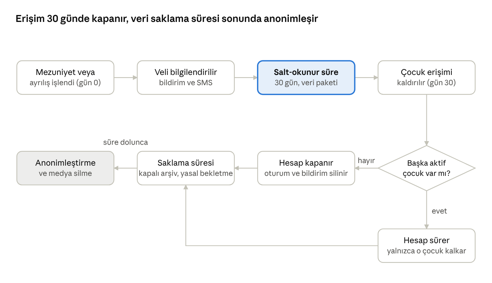

# 08 Mezuniyet ve Ayrılış

Mezuniyet veya ayrılışta velinin erişimi salt-okunur sürenin (öneri 30 gün, S3) ardından kapanır; veriler saklama süresi boyunca tutulur, sonra anonimleştirilir ya da silinir.

## Amaç, kapsam ve aktörler

Modül, bir çocuğun okulla ilişkisi bittiğinde uygulamadaki tüm izlerinin tanımlı bir sırayla kapanmasını sağlar: veliye kısa bir erişim süresi, ardından erişimin kalkması, verilerin yasal süre boyunca kapalı tutulması ve sonunda anonimleştirilmesi. Mezun çocukla ve velisiyle uygulama üzerinden hiçbir iletişim sürmez (karar K9).

**Kapsam içi**

- Tetikleyiciler: yıl sonu toplu mezuniyet (01 devir sihirbazının mezuniyet adımı), bireysel ayrılış (herhangi bir tarihte), marka dışına nakil, okul kapatma (01, Faz 2).
- Salt-okunur süre (öneri 30 gün): veli raporları, portfolyoyu (Faz 2) ve fotoğrafları (Faz 3) görür ve indirir; mesaj yazamaz.
- Veri paketi: velinin tek dokunuşla indirdiği arşiv (gelişim raporları ve devam özeti; Faz 2'den itibaren portfolyo, görüşme özetleri ve sağlık kayıtları; Faz 3'ten itibaren fotoğraflar).
- Erişim iptali: çocuk velinin kapsamından çıkar; başka aktif çocuğu olmayan veli hesabı devre dışı kalır; bildirim belirteçleri silinir.
- Personel erişimi: çocuk öğretmen listelerinden düşer; müdür ve ofis arşiv görünümünden salt-okunur erişir.
- Saklama ve anonimleştirme: veri sınıfı bazında süreler; süre dolunca kişisel alanlar anonimleştirilir, medya silinir.
- Yeniden kayıt ve kardeş senaryoları.
- Denetim raporu: süreçten geçen kayıtlar; açık kalan erişim hedefi sıfır.

**Kapsam dışı**

- Mezunlarla pazarlama, etkinlik daveti, bülten (K9; ayrı rıza ve ayrı sistem gerektirir).
- Aidat kapanış hesapları (14 İleri Faz).
- Personel ayrılış süreci (02 Kullanıcılar, hesap kapatma).

**Aktörler**

| Aktör | Modüldeki işi |
| --- | --- |
| Okul müdürü | Toplu mezuniyeti devir sihirbazından (01) başlatır ve onaylar, bireysel ayrılışı onaylar, arşivden salt-okunur bakar |
| Ofis | Ayrılış kaydını girer, veri paketi taleplerini izler, yeniden kaydı yapar |
| Veli | Bilgilendirilir, veri paketini indirir, süre sonunda erişimi kalkar |
| Öğretmen | Mezun çocuğu listelerinde görmez; arşive erişimi yoktur |
| Marka yöneticisi | Saklama politikasını ayarlar, denetim raporunu izler, okul kapatmada toplu ayrılışı başlatır (Faz 2) |
| Sistem (zamanlanmış işler) | Süre bitimini uygular, hesapları kapatır, anonimleştirmeyi çalıştırır |

## Kullanıcı hikayeleri

| ID | Rol | Hikaye | Öncelik | Faz |
| --- | --- | --- | --- | --- |
| MZ-01 | Okul müdürü | Yıl sonunda mezuniyet sınıfındaki tüm çocukları önizleyip tek işlemle mezun etmek istiyorum, böylece tek tek kapatmayayım. | Must | MVP |
| MZ-02 | Ofis | Yıl ortasında ayrılan çocuğu ayrılış tarihi ve nedeniyle kapatmak istiyorum, böylece kayıt düzgün kapansın. | Must | MVP |
| MZ-03 | Veli | Çocuğum mezun olduğunda raporlarını ve fotoğraflarını tek dokunuşla indirmek istiyorum, böylece anılar bende kalsın. | Must | MVP |
| MZ-04 | Veli | Erişimimin ne zaman biteceğini önceden bilmek istiyorum, böylece hazırlıksız kalmayayım. | Must | MVP |
| MZ-05 | Sistem | Süre dolunca velinin çocuğa erişimini, başka çocuğu yoksa hesabını kendiliğinden kapatmak istiyorum, böylece elle takip gerekmesin. | Must | MVP |
| MZ-06 | Öğretmen | Mezun olan çocukların sınıf listemde ve mesajlarımda görünmemesini istiyorum, böylece listem güncel kalsın. | Must | MVP |
| MZ-07 | Ofis | Kardeşi okulda devam eden velinin hesabının açık kalmasını, yalnızca mezun çocuğun kapanmasını istiyorum. | Must | MVP |
| MZ-08 | Ofis | Geri dönen bir çocuğu eski kaydına bağlayarak yeniden kaydetmek istiyorum, böylece geçmişi kaybolmasın. | Should | MVP |
| MZ-09 | Marka yöneticisi | Saklama sürelerini veri sınıfı bazında ayarlamak ve süresi dolan verinin anonimleştirildiğini raporda görmek istiyorum. | Must | MVP |
| MZ-10 | Okul müdürü | Mezun çocuğun geçmiş raporlarını hukuki gereklilik halinde arşivden görebilmek istiyorum, böylece talebe yanıt verebileyim. | Should | MVP |
| MZ-11 | Veli | Çocuğumun verilerinin silinmesini uygulamadan talep etmek istiyorum (KVKK), böylece dilekçe yazmayayım. | Should | Faz 2 |
| MZ-12 | Ofis | Marka dışı bir okula nakilde veliye veri paketine ek olarak tek sayfalık PDF özet vermek istiyorum, böylece yeni okula bilgi taşınsın. | Could | Faz 2 |

## İş kuralları ve işlevsel gereksinimler

**Tetikleyiciler ve zaman çizgisi**

1. Yıl sonu toplu mezuniyet: tek giriş noktası 01'deki devir sihirbazının mezuniyet adımıdır. Müdür mezuniyet yaş grubundaki (marka yaş grubu işareti) tüm aktif kayıtları önizler, mezuniyet tarihini (varsayılan eğitim yılı bitişi) seçer ve onaylar; onay bu modülün mezuniyet olayını üretir, salt-okunur süre mezuniyet tarihinde başlar ve yaz boyunca işler, sınıf taşıma ise yeni yılın ilk gününde yürürlüğe girer. İşlem 72 saat içinde geri alınabilir.
2. Bireysel ayrılış: ofis ayrılış tarihi ve nedenini (marka dışı nakil, aile kararı, diğer) girer, müdür onaylar. Marka içi nakil bu modülü tetiklemez (03 kural 11). Okul kapatma (01, Faz 2): marka yöneticisi kapatma tarihini seçer; o tarihte okulun tüm aktif kayıtları “okul kapandı” nedeniyle toplu ayrılış olarak işlenir.
3. Durum mezun veya ayrıldı olunca salt-okunur süre başlar: öneri 30 gün (marka ayarı, 0–90 gün; S3). Veli ilk gün ile bitişten 7 gün ve 1 gün önce bilgilendirilir.
4. Salt-okunur sürede veli geçmiş raporları ve devam özetini, Faz 2'den itibaren portfolyoyu ve görüşme özetlerini, Faz 3'ten itibaren fotoğrafları görür ve veri paketini indirir. Mesaj yazamaz, duyuru almaz, yoklama ve etkinlik görmez; çocuk kanalı arşivdedir ve eski mesajlar okunabilir.
5. Süre sonunda çocuk velinin uygulamasından kalkar. Velinin markada başka aktif çocuğu yoksa hesap devre dışı kalır: giriş engellenir, bildirim belirteçleri silinir, oturumlar sonlandırılır. Başka aktif çocuğu varsa hesap sürer. Erişim sona erdiğinde uygulama çocuğa ait yerel önbelleği (son görülen veri, gönderilmemiş kuyruk) siler; devre dışı kalan velinin kullanıcı kaydı (ad, telefon, tercihler) kimlik veri sınıfının saklama süresine tabidir ve onunla birlikte anonimleştirilir.
6. Personel: mezuniyet anında çocuk öğretmen listelerinden, yoklamadan ve mesaj listesinden düşer. Müdür ve ofis arşiv görünümünden salt-okunur erişir; her erişim denetim izine düşer.

**Veri paketi**

7. İçerik: gelişim raporları (PDF), portfolyo dosyaları, çocuğun etiketli olduğu ve rıza kapsamında velisine ait fotoğraflar (Faz 3), devam özeti (PDF), görüşme özetleri (Faz 2), sağlık kayıtları PDF'i (Faz 2). Mesaj geçmişi dahil değildir; ihtilafta ofisten istenir.
8. Paket talep üzerine arka planda hazırlanır ve 24 saat içinde indirilebilir bağlantıyla sunulur; bağlantı 7 gün ve en az salt-okunur sürenin bitimine kadar geçerlidir, velinin oturumuyla korunur; paket indirilmemişse bitime 3 gün kala hatırlatma gider.

**Saklama ve anonimleştirme**

9. Saklama süreleri veri sınıfı bazında marka ayarıdır ve hukuk görüşüyle belirlenir (K14). Yer tutucu varsayılanlar Kesişen Konular'daki KVKK tablosundadır.
10. Süre dolunca kimlik alanları (ad, soyad, doğum tarihi, kimlik no, fotoğraf, veli bağlantıları, iletişim) anonimleştirilir; medya ve mesaj içeriği silinir. İstatistik için yalnızca okul, yaş grubu, dönem ve sayısal özetler kalır.
11. Anonimleştirme günlük zamanlanmış işle çalışır; her çalıştırma denetim raporuna yazılır (kaç kayıt, hangi veri sınıfı).
12. Yasal gereği uzun tutulan belgeler (örneğin kayıt sözleşmesi) okulun resmi arşivinde tutulur; uygulama bunları süre sonunda siler (doğrulanmalı).
13. İhtilaf veya resmi talep halinde kayıt “yasal bekletme” işaretlenir; anonimleştirme işaret kalkana kadar durur.

**Yeniden kayıt ve kardeşler**

14. Mezun veya ayrılmış çocuğun yeniden kaydı, anonimleştirme öncesinde aynı kişi kaydına bağlanır ve geçmiş raporlar yeniden görünür olur. Anonimleştirme sonrası yeni kişi kaydı açılır.
15. Devre dışı veli hesabı yeniden davet edilirse aynı telefon numarasıyla açılır; eski tercihler korunur.

**Mezunlarla iletişim**

16. Mezun çocuk ve velisine uygulama üzerinden duyuru, mesaj veya bildirim gönderilemez; sistem bu kapsamı tüm alıcı listelerinden çıkarır. Mezunlara yönelik iletişim bu platformun dışındadır ve ayrı açık rıza gerektirir (K9).

**Denetim**

17. Mezuniyet denetim raporu: dönem bazında mezun ve ayrılan kayıt sayısı, süresi bittiği halde erişimi açık kalan kayıt (hedef 0), anonimleştirme bekleyen ve tamamlanan kayıtlar, yasal bekletmedeki kayıtlar.

## Süreç akışı

İki yol aynı yere çıkar: başka aktif çocuğu olan velinin hesabı sürer, olmayanınki kapanır; her iki durumda da çocuğun verisi saklama süresi boyunca kapalı arşivde kalır ve süre dolunca anonimleştirilir. Gri dolgulu kutu sürecin sonudur.

## Veri, ekranlar ve bildirimler

**Varlıklar**

| Varlık | Anahtar alanlar | Not |
| --- | --- | --- |
| Ayrılış kaydı | kayıt, tür (mezuniyet / ayrılış), tarih, neden, başlatan, onaylayan, salt-okunur bitişi, geri alma süresi | 03'teki durum geçişi olayını dinler |
| Veri paketi talebi | kayıt, veli, talep zamanı, hazır zamanı, bağlantı, indirildi mi, geçerlilik | 7 gün |
| Saklama politikası | marka, veri sınıfı, süre, işlem (anonimleştir / sil) | Hukuk görüşüyle doldurulur |
| Anonimleştirme işi | çalıştırma zamanı, etkilenen kayıt sayısı, veri sınıfı, sonuç | Günlük |
| Erişim iptali olayı | kullanıcı, çocuk, zaman, hesap kapatıldı mı | Denetim raporunun kaynağı |
| Yasal bekletme | kayıt, neden, başlangıç, kaldıran | Anonimleştirmeyi durdurur |

**Ekranlar**

| Ekran | Platform | Rol | İçerik |
| --- | --- | --- | --- |
| Toplu mezuniyet | Web | Okul müdürü | 01 devir sihirbazının mezuniyet adımı: önizleme (eksik rapor uyarısı), tarih, onay, geri al |
| Ayrılış kaydı | Web | Ofis, müdür | Tarih, neden, onay |
| Arşiv görünümü | Web | Müdür, ofis | Mezun çocuk kartı salt-okunur; erişim denetim izine yazılır |
| Saklama politikası | Web | Marka yöneticisi | Veri sınıfı, süre, işlem; yasal bekletme listesi |
| Mezuniyet denetim raporu | Web | Marka yöneticisi, müdür | Kayıt sayıları, açık erişim, anonimleştirme durumu |
| Mezuniyet bilgi ekranı | Mobil | Veli | Süre, ne görülebileceği, veri paketi düğmesi |
| Veri paketi indir | Mobil | Veli | Talep, hazır bildirimi, indir |
| Erişim sona erdi | Mobil (giriş ekranı) | Veli | Açıklama ve okulun iletişim bilgisi |

**Bildirimler**

| Olay | Alıcı | Kanal | Zamanlama |
| --- | --- | --- | --- |
| Mezuniyet veya ayrılış işlendi | Tam ve sınırlı veliler | Anlık bildirim, SMS | İlk gün |
| Salt-okunur süre bitiyor | Veliler | Anlık bildirim | 7 gün ve 1 gün önce |
| Veri paketi hazır | Talep eden veli | Anlık bildirim, SMS, e-posta (varsa) | Hazır olunca |
| Erişim sona erdi | Veliler | SMS | Süre bitişinde |
| Toplu mezuniyet tamamlandı | Müdür, marka yöneticisi | E-posta | İşlem sonunda |
| Anonimleştirme raporu | Marka yöneticisi | E-posta | Aylık |
| Açık kalan erişim tespiti | Marka yöneticisi | Uygulama içi uyarı | Günlük kontrol |

## Uç durumlar, kabul kriterleri ve açık sorular

**Uç durumlar**

- Mezun çocuğun kardeşi okulda: veli hesabı açık kalır, yalnızca mezun çocuk kalkar.
- Yanlışlıkla mezun edilen çocuk: 72 saat içinde geri alınır; erişim ve kanallar geri gelir.
- Ayrılış tarihi geçmişe girildi: salt-okunur süre giriş tarihinden başlar, geçmiş tarihten değil.
- Veri paketi süresi içinde indirilmedi: ofis, salt-okunur süre bitiminden sonraki 30 gün içinde (medya silinmeden önce) yeniden üretebilir.
- Veli süre sonunda giriş yapmayı dener: giriş ekranında açıklama ve okulun iletişim bilgisi görünür.
- Mahkeme veya resmi talep: kayıt yasal bekletmeye alınır, anonimleştirme durur.
- Velinin silme talebi saklama süresi dolmadan gelirse: hukuk görüşüne göre yasal zorunlu alanlar hariç silinir; talep ve yanıt denetim izine yazılır.
- Mezuniyet anında yayınlanmamış taslak rapor: önizlemede uyarı; müdür isterse önce yayınlatır.
- Grup fotoğraflarında mezun çocuk: salt-okunur süre bitiminde çocuğun etiketleri kaldırılır ve grup medyası diğer velilere kapanır; kendi velisi veri paketiyle almıştır; dosyalar 30 gün sonra silinir (S12).

**Kabul kriterleri**

- 200 çocukluk toplu mezuniyet (marka geneli, 10× yük testi) önizleme dahil 5 dakikada tamamlanır.
- Süre sonunda hiçbir mezun çocuk için veli API'si veri döndürmez (zaman ilerletmeli otomatik test).
- Başka aktif çocuğu olan velinin hesabı açık kalır; olmayanın hesabı kapanır (otomatik test).
- Veri paketi 24 saat içinde hazırlanır; bağlantı 7 gün sonra, en erken salt-okunur süre bitiminde geçersiz olur.
- Anonimleştirme sonrası kişisel alanlarda arama sonuç vermez; sayısal özetler raporlarda kalır.
- Mezun kapsamı duyuru, mesaj ve bildirim alıcı listelerine girmez (otomatik test).

**Açık sorular**

- [ ] Salt-okunur süre 30 gün uygun mu? (S3)
- [ ] Veri sınıfı bazında saklama süreleri (hukuk görüşü; S4).
- [ ] Grup fotoğraflarında mezun çocuk için politika (S12; öneri: etiket kaldırma ve 30 gün sonra silme)
- [ ] Mezuniyet belgesi (PDF) üretilsin mi?
- [ ] Veli silme talebi akışı MVP'ye alınsın mı? (Öneri: Faz 2; MVP'de ofis üzerinden)
- [ ] Marka dışı nakilde veri aktarım formatı (PDF özet yeterli mi?)
